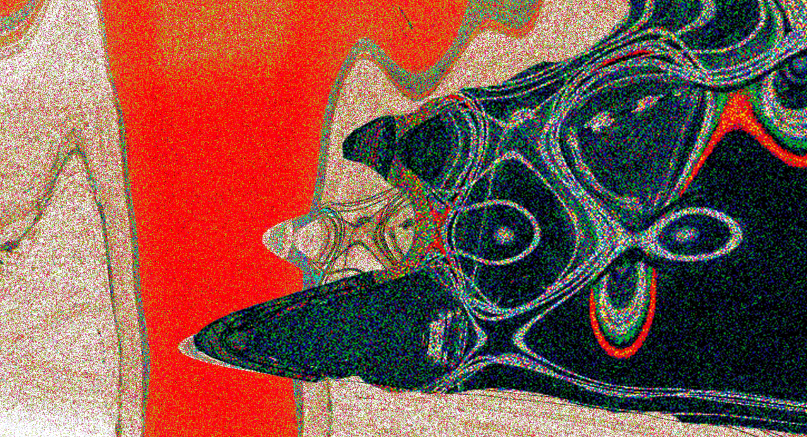

- Thursday, 26 November 2026, 18:00–19:00
- Toni-Areal, Composition Studio 3.D02, Level 3
- Pfingstweidstrasse 96, Zurich

_Free admission_

---

**#21 ascolta** presents **Yoko Konishi**, who spent three weeks as an artist in residence at the ICST Composition Studio from late August to mid-September 2026. She returns to Zurich for this listening session to present a work-in-progress version of the piece she developed at ICST, followed by a Q&A. The finished piece will premiere at SONIC MATTER 2027.

---

## Programme

### _Fluctuating Beings_ (2026, work in progress)

Composed mainly from recordings of feedback sound produced on a bass drum. In its original version, the feedback is also generated and performed live with a different setup; for this listening session, an acousmatic version of the work will be presented.

### _Corpus Lucide_

Yoko Konishi's final project for the IRCAM Cursus explores noise as a musical theme. Rather than using recorded noise as its starting material, the work constructs noise from scratch through combinations of sine waves.

---

## Yoko Konishi

Yoko Konishi is a Japanese sound artist and performer currently based in France. Her practice centres on the intersection of sound, body and technology through spatial audio, interactive systems and sensor-based processes. She holds a Master's degree in Ambisonics and spatial sound composition from Université Paris 8, attended a post-master's programme at the mdw – University of Music and Performing Arts Vienna, and completed IRCAM's Cursus programme in 2024–25.
