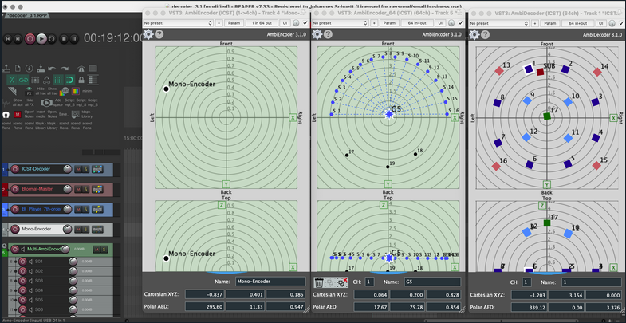

Level: Beginner | Zielgruppe: Komponist:in, Techniker:in, Studierende, Studio-User. Nutze diese Seite für eine schnelle Orientierung vor Setup, Routing oder Plugin-Details.

Die ICST Ambisonics Plugins bilden eine REAPER-basierte Produktionsumgebung für Higher-Order Ambisonics: Quellen positionieren, B-Format encodieren, Lautsprecher-Arrays decodieren, Sessions mit Vorlagen aufbauen und externe Kontrolle über OSC anbinden.

## Hier starten

| Ziel | Seiten |
|---|---|
| Erste funktionierende Session, Routing von Grund auf, B-Format korrekt exportieren | [Schnellstart](/de/icst-ambisonics-plugins/04_quick_start/) → [Schritt-für-Schritt-Setup](/de/icst-ambisonics-plugins/06_step_by_step_setup/) → [B-Format in REAPER rendern](/de/icst-ambisonics-plugins/12_render_bformat/) |
| Saubere Installation | [Installation](/de/icst-ambisonics-plugins/02_installation/) |
| Signalfluss verstehen | [Wie es funktioniert](/de/icst-ambisonics-plugins/03_how_it_works/) → [ICST Decoder](/de/icst-ambisonics-plugins/08_icst_decoder/) → [Best Practices](/de/icst-ambisonics-plugins/17_best_practices/) |
| Bewegung und externe Steuerung | [ICST Encoders](/de/icst-ambisonics-plugins/10_icst_encoders/) → [OSC](/de/icst-ambisonics-plugins/13_osc/) → [Best Practices](/de/icst-ambisonics-plugins/17_best_practices/) |

## Zentrale Plugin-Kette

`Quelle -> Encoder -> Bformat Master -> Decoder -> Lautsprecher`

Optionaler Monitoring-Zweig: `Bformat Master -> Binaural-Decoder -> Kopfhörer`. Siehe auch [Signalfluss auf einen Blick](/de/ambisonics-101/#signalfluss).

- **Encoder** positionieren oder bewegen Quellen im Ambisonics-Feld.
- Der **Bformat Master** sammelt das encodierte HOA-Signal.
- Der **Decoder** übersetzt das B-Format in Lautsprecherwiedergabe.
- Für Kopfhörer-Monitoring wird ein separater **Binaural-Decoder** verwendet.
- Finale Exporte sollten vom **Bformat Master** gerendert werden, nicht vom Decoder-Ausgang.

## Was die Suite umfasst

Formate: `VST3`, `AU (Component)` und `LV2`. LV2 ist derzeit experimentell und sollte nicht als primärer Produktionspfad betrachtet werden.

- **ICST Encoders** für Quellenpositionierung und Bewegung
- **ICST Decoder** für Lautsprecherwiedergabe
- **ICST MultiDecoder** für geschichtete oder segmentierte Lautsprecher-Arrays
- **Spurvorlagen** und **Projektvorlagen** für schnellere Setups
- **OSC-Unterstützung** für externe Steuerungs-Workflows

## Downloads und Referenzen

- Plugin-Releases: <https://github.com/schweizerweb/icst-ambisonics-plugins/releases>
- Projekt-Wiki: <https://github.com/schweizerweb/icst-ambisonics-plugins/wiki>
- Tutorials und Site-Hub: <https://ambisonics.ch/>
- YouTube-Kanal: <https://www.youtube.com/@ZHDK_ICST>

## Entwicklung

Entwicklerteam: Christian Schweizer, Johannes Schütt, Martin Neukom. Zusätzliche Produktionsunterstützung: Axel Kolb (Video Creator und Beta Tester).
