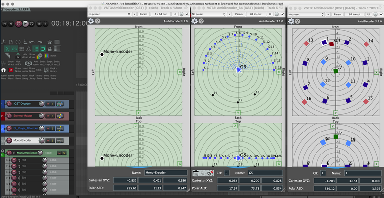

Level: Beginner | Audience: composer, technician, student, studio user. Use this page for a fast orientation before setup, routing or plugin details.

The ICST Ambisonics Plugins form a REAPER-based production environment for Higher-Order Ambisonics: source positioning, B-format encoding, loudspeaker decoding, template-based session building, and OSC-based control.

## Start here

| Goal | Pages |
|---|---|
| First working session, routing from scratch, correct master export | [Quick Start](/icst-ambisonics-plugins/04_quick_start/) → [Step by Step Setup](/icst-ambisonics-plugins/06_step_by_step_setup/) → [Render B-Format in REAPER](/icst-ambisonics-plugins/12_render_bformat/) |
| Clean installation | [Installation](/icst-ambisonics-plugins/02_installation/) |
| Understand the signal flow | [How it Works](/icst-ambisonics-plugins/03_how_it_works/) → [ICST Decoder](/icst-ambisonics-plugins/08_icst_decoder/) → [Best Practices](/icst-ambisonics-plugins/17_best_practices/) |
| Movement and external control | [ICST Encoders](/icst-ambisonics-plugins/10_icst_encoders/) → [OSC](/icst-ambisonics-plugins/13_osc/) → [Best Practices](/icst-ambisonics-plugins/17_best_practices/) |

## Core plugin chain

`Source -> Encoder -> Bformat Master -> Decoder -> Speakers`

Optional monitoring branch: `Bformat Master -> Binaural Decoder -> Headphones`. See also [Signal Flow at a Glance](/ambisonics-101/#signal-flow).

- **Encoders** place or move sources in the Ambisonics field.
- The **Bformat Master** collects the encoded HOA signal.
- The **Decoder** turns the B-format field into loudspeaker playback.
- A separate **binaural decoder** is used for headphone monitoring.
- Final exports should be rendered from the **Bformat Master**, not from the decoder output.

## What the suite includes

Formats: `VST3`, `AU (Component)` and `LV2`. LV2 is currently experimental and should not be treated as the primary production path.

- **ICST Encoders** for source positioning and movement
- **ICST Decoder** for loudspeaker playback
- **ICST MultiDecoder** for layered or segmented loudspeaker arrays
- **Track templates** and **project templates** for faster setup
- **OSC support** for external control workflows

## Downloads and references

- Plugin releases: <https://github.com/schweizerweb/icst-ambisonics-plugins/releases>
- Project documentation wiki: <https://github.com/schweizerweb/icst-ambisonics-plugins/wiki>
- Tutorials and site hub: <https://ambisonics.ch/>
- YouTube channel: <https://www.youtube.com/@ZHDK_ICST>

## Development

Developer team: Christian Schweizer, Johannes Schütt, Martin Neukom. Additional production support: Axel Kolb (video editing).
