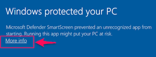
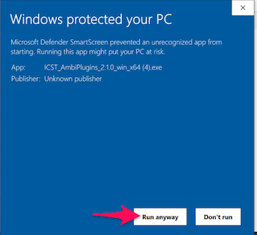
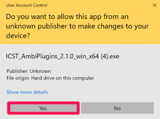
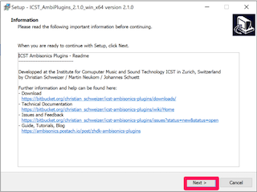
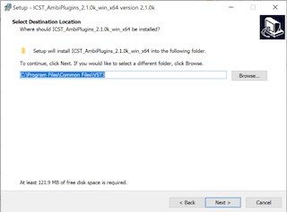
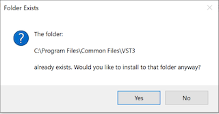
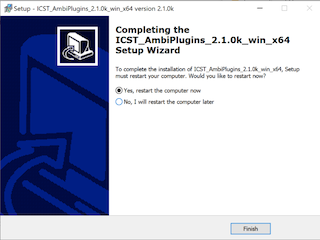

Level: Beginner | Audience: Composer, technician, student, studio user.

Use this page when you want a clean plugin installation before opening templates or building a REAPER session from scratch.

> **Shortcut:** If you would rather not set up REAPER yourself, the [ICST Ambi REAPER Bundle](/icst-ambisonics-plugins/19_icst_ambi_reaper_bundle/) is a portable, preconfigured REAPER folder with toolbar, scripts and plugins already in place.

## Before you start

For a reliable installation, make sure you have:

- a current version of **REAPER**
- the **SWS / S&M extension**
- **ReaPack**
- access to the current ICST plugin release package

Recommended next step after installation:

- [Quick Start](/icst-ambisonics-plugins/04_quick_start/) for the fastest first session
- [Step by Step Setup](/icst-ambisonics-plugins/06_step_by_step_setup/) if you want to build the routing manually

## Install on macOS

1. Download **REAPER** for Apple Silicon or Intel from [reaper.fm](https://www.reaper.fm/).
2. Install and open REAPER once.
3. Close REAPER again.
4. Install the **SWS / S&M extension** from <https://www.sws-extension.org/>.
5. Install **ReaPack** from <https://reapack.com/>.
6. Follow the ReaPack installation guide: <https://reapack.com/user-guide#installation>
7. Download the current ICST Ambisonics Plugins release from <https://github.com/schweizerweb/icst-ambisonics-plugins/releases>.
8. Run the macOS installer.

## Install on Windows

1. Download **REAPER** for Windows from [reaper.fm](https://www.reaper.fm/).
2. Install and open REAPER once.
3. Close REAPER again.
4. Install the **SWS / S&M extension** from <https://www.sws-extension.org/>.
5. Install **ReaPack** from <https://reapack.com/>.
6. Follow the ReaPack installation guide: <https://reapack.com/user-guide#installation>
7. Download the current ICST Ambisonics Plugins release from <https://github.com/schweizerweb/icst-ambisonics-plugins/releases>.
8. Run the Windows installer or extract the release to the standard VST3 location if the package requires manual placement.

*1. SmartScreen warning: click “More info”.*

*2. Click “Run anyway”.*

*3. Confirm the User Account Control prompt with “Yes”.*

*4. Read the notes and click “Next”.*

*5. Keep the VST3 folder and click “Next”.*

*6. If the folder already exists, confirm with “Yes”.*

*7. Finish the setup; restart now or later.*

## Installed files and folders

Typical installation targets:

- `/Library/Audio/Plugins/VST3`
- `/Library/Audio/Plugins/Components`
- `/Library/Audio/Plugins/LV2` (experimental)
- `Users/Shared/AmbiPluginsTemp/ProjectTemplates`
- `Users/Shared/AmbiPluginsTemplatesTemp/TrackTemplates`

Templates usually include:

- `ICST_AmbiPlugins_MonoEncoder.RPP`
- `ICST_AmbiPlugins_MultiEncoder.RPP`
- `ICST_AmbiPlugins`
- `ICST_AmbiPlugins_3rdParty`

## If the plugins do not appear

Check these points first:

- REAPER has been restarted after installation.
- The **SWS** extension is installed correctly.
- **ReaPack** is installed correctly.
- The plugin files were placed in the expected VST3 / AU / LV2 directories.
- The ICST plugins appear in the REAPER **FX Browser** after a plugin rescan.

If the templates are missing, also check the shared template folders listed above.

## Related references

- Project wiki: <https://github.com/schweizerweb/icst-ambisonics-plugins/wiki>
**Installation video: ICST Ambisonics Plugins – 01 – How to Install**



## Next step

- [Quick Start](/icst-ambisonics-plugins/04_quick_start/)
- [Step by Step Setup](/icst-ambisonics-plugins/06_step_by_step_setup/)
