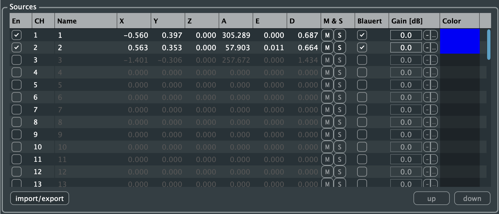
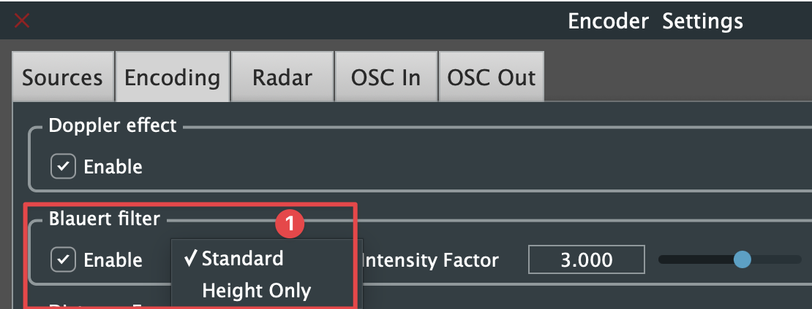
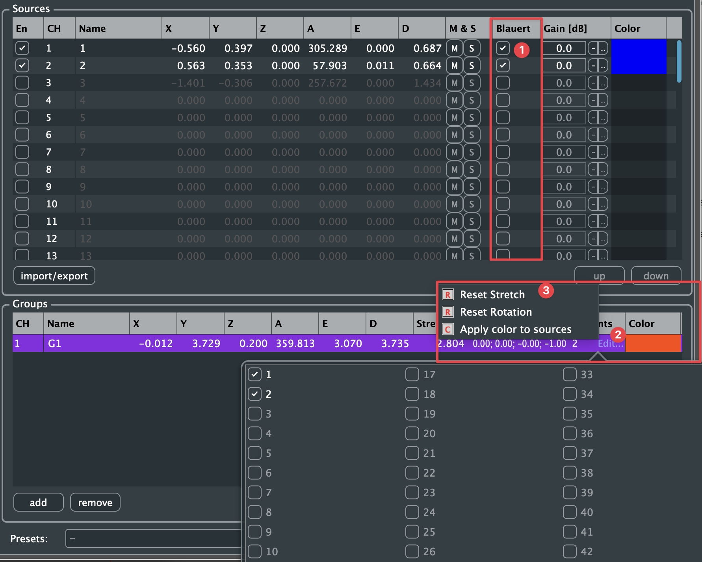
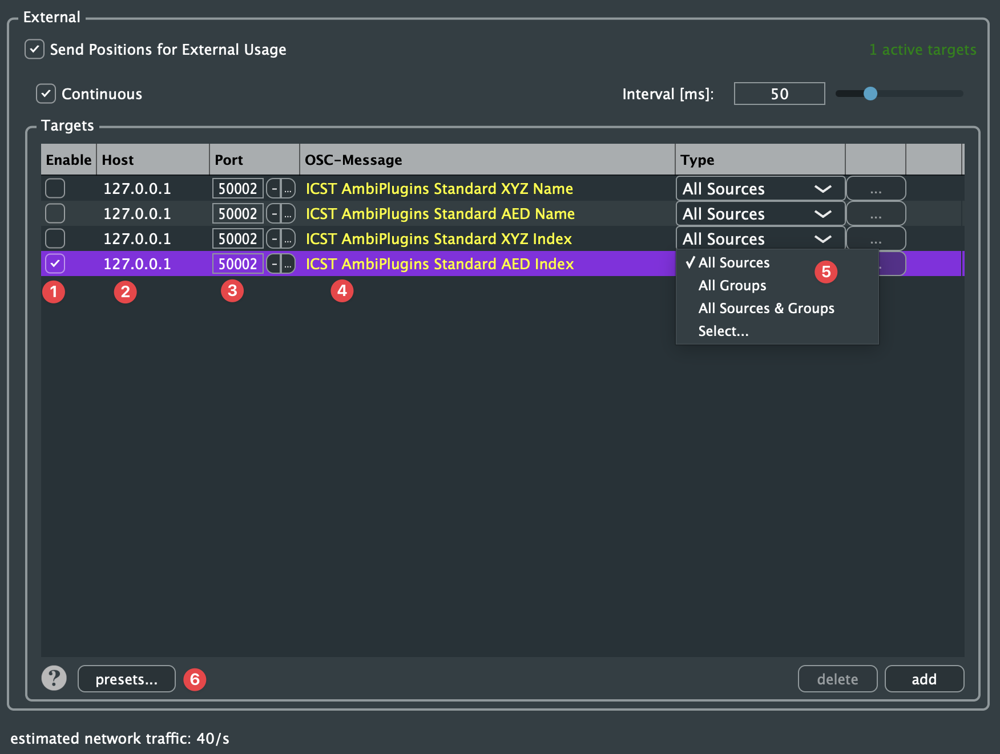
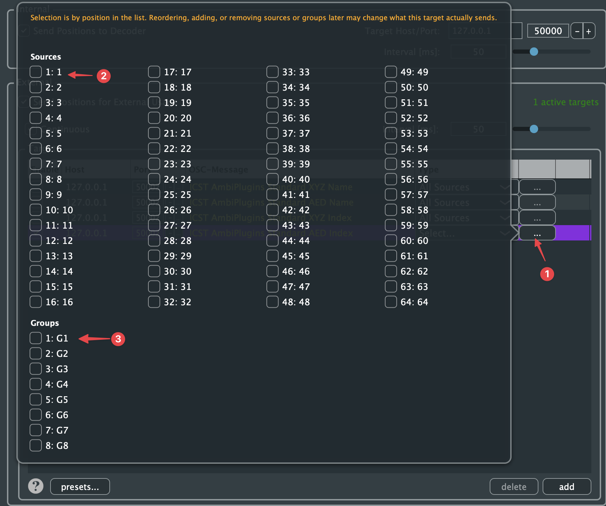

Level: Intermediate | Audience: Composer, technician, student, interactive-media user.

Use this page when you want to place, move, group, or automate sources inside the Ambisonics field.

If you are unsure what **B-Format**, **ambiX**, **ACN/SN3D**, or **64 channels** mean before choosing encoder settings, read [Ambisonics Formats Explained](/learn/ambisonics-formats/) first.

## When to use which encoder

Use **MonoEncoder** when:

- you want to position one source at a time
- you are learning the workflow
- you want the clearest per-source routing

Use **MultiEncoder** when:

- you want to control many sources in one interface
- you need source grouping
- you want to record or edit larger movement structures
- you want OSC-based interaction with multiple sources

## What the encoders do

The **ICST Encoders** position and move sound sources inside the Ambisonics B-format field.

- **MonoEncoder** handles one mono source.
- **MultiEncoder** handles up to 64 sources on one track and organizes them into up to 8 groups.

A distinctive feature is the built-in **distance simulation**, which combines lowpass filtering and a Doppler-style effect to shape depth perception.

OSC input and output make the encoders usable in controller-based and algorithmic workflows.

## Overview

Top left the **MonoEncoder** (one source), bottom left the **MultiEncoder** with three groups, on the right the **Encoder Settings** window.

1. **Settings** (gear) – opens the Encoder Settings window.
2. **Help** (?)
3. **Sources** – source list with position (X/Y/Z, A/E/D), mute/solo, gain and colour.
4. **Encoding** – encoding settings.
5. **Radar** – radar display settings.
6. **OSC In** – receiving OSC messages.
7. **OSC Out** – sending the encoder state via OSC.
8. **Distance Scaler** – distance simulation via lowpass filtering and Doppler-style behaviour.
9. **Infinite** – place sources at the far-field boundary.
10. **Master Gain [dB]** – overall level of the encoder.
11. **import/export** – save or load source configurations.
12. **Groups** – group editor with position, stretch, rotation, number of points and colour; groups can be moved relative to their centre.
13. **Presets** – save and manage complete encoder states for repeatable setups (save, manage…).

**Video: ICST Ambisonics Plugins – 02 – AmbiEncoder**



## User interface

### Source window

This area shows and controls individual sources by azimuth, elevation, and distance.

**New in 4.0:** the **Blauert** column switches the Blauert filter on or off per source (settings see [Encoding settings](#encoding-settings)).

### Encoding settings

This section sets core encoding parameters such as order and channel format.

**New in 4.0:** in the **Encoding** tab, the **Doppler effect** and the **Blauert filter** can be enabled separately. The Blauert filter has two modes, **Standard** and **Height Only** (acts on the Z axis only), and an **Intensity Factor** (in %) that sets the strength of the filter.

### Radar

The radar gives a top-down view of the field and makes source positions and groups directly editable.

## Grouping and movement

MultiEncoder is especially useful when spatial movement is not just individual, but structural:

- several sources can be grouped
- groups can be moved relative to a group center
- larger spatial choreographies can be recorded and refined

Use grouping when the scene should behave as a coherent object rather than as unrelated single sources.

**New in 4.0:**

1. **Blauert** – Blauert filter per source.
2. **Edit…** in the # Points column – opens a selection of all 64 sources; ticked sources belong to the group.
3. **Group context menu** – **Reset Stretch**, **Reset Rotation** and **Apply color to sources** (applies the group colour to its sources).

## OSC integration

- **OSC input and JavaScript** receive external control messages
- **OSC output** sends encoder state to controllers or external applications

**New in 4.0: OSC Out to external targets.** In the **OSC Out** tab, *Send Positions for External Usage* sends the positions to any number of targets, optionally continuously (*Continuous*) at the set interval (ms). At the bottom the tab shows the estimated network traffic.

1. **Enable** – switch the target on or off.
2. **Host** – IP address of the receiver.
3. **Port** – target port.
4. **OSC-Message** – message format, e.g. *ICST AmbiPlugins Standard XYZ/AED* with name or index.
5. **Type** – what is sent: All Sources, All Groups, All Sources & Groups or Select….
6. **presets…** – save and load target configurations.

With **Select…**, the **…** button opens a selection of individual sources and groups:


The selection is by **position in the list**. If sources or groups are reordered, added or removed later, the target may send different data.


**Video: ICST Ambisonics Plugins – 03 – OSC Part 1**



For setup and syntax:

- [OSC](/icst-ambisonics-plugins/13_osc/)

## Common mistakes

- using MultiEncoder when a simple MonoEncoder track would be clearer
- changing distance scaling late in the project and breaking movement consistency
- forgetting that encoder routing must still end in a stable Bformat Master
- treating OSC as required when normal REAPER automation would be enough
- grouping sources without clear naming, which makes later editing harder

## Next step

- [Step by Step Setup](/icst-ambisonics-plugins/06_step_by_step_setup/)
- [Ambisonics Formats Explained](/learn/ambisonics-formats/)
- [OSC](/icst-ambisonics-plugins/13_osc/)
- [Best Practices](/icst-ambisonics-plugins/17_best_practices/)
