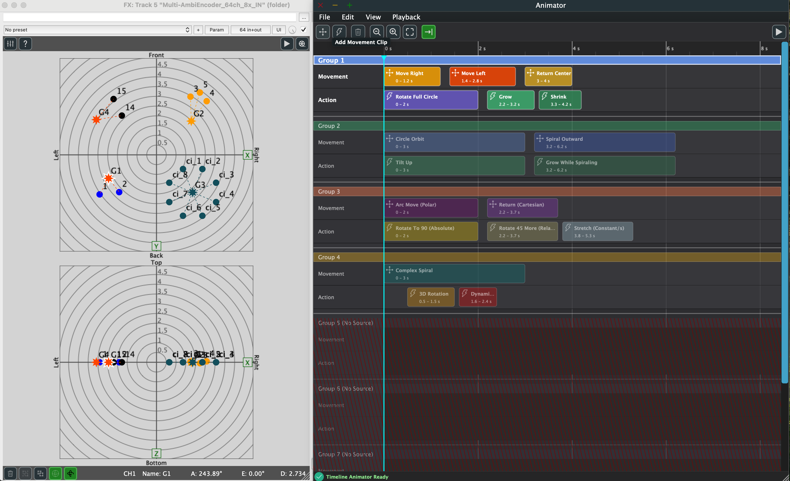
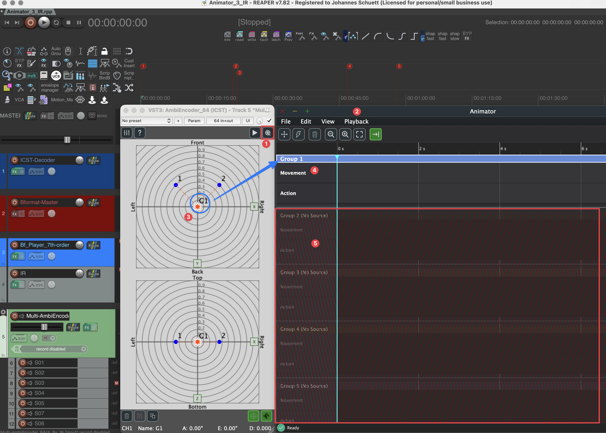
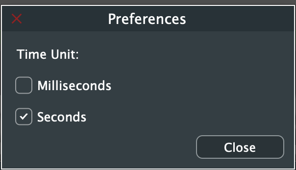
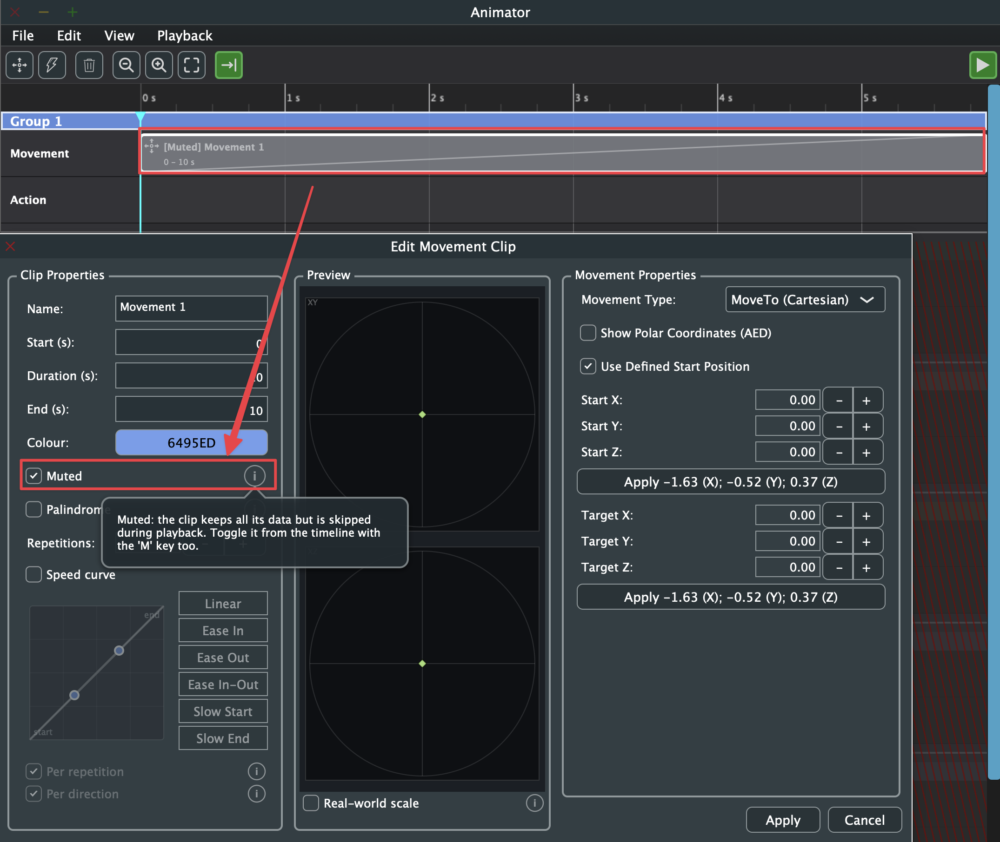
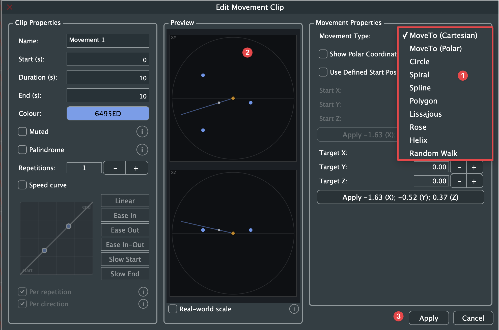
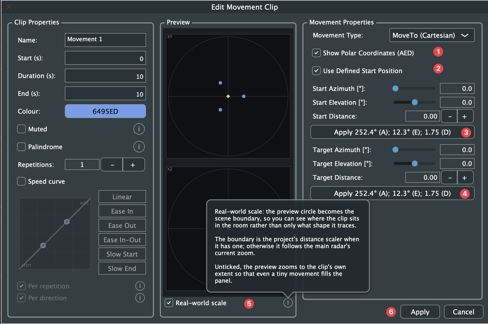
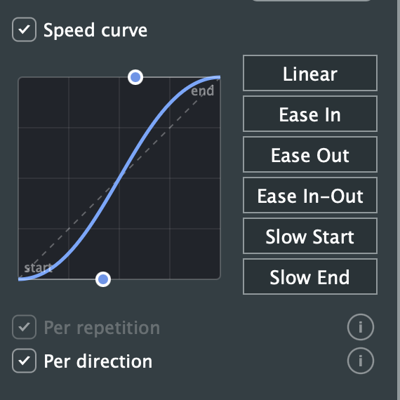

Level: Intermediate | Audience: Composer, technician, student, interactive-media user. | **Version: ICST Ambisonics Plugins 4.0**

<!-- TODO release: insert download link -->

<button type="button" disabled aria-disabled="true" style="display:inline-block;padding:.6em 1.4em;border:0;border-radius:6px;background:#2e8b57;color:#fff;font-weight:600;font-size:1em;opacity:.55;cursor:not-allowed;">Download Animator &nbsp;·&nbsp; Coming soon</button>

The **Animator** is the choreography timeline of the **Multi-AmbiEncoder_64**: it moves, rotates and reshapes entire source groups automatically over time, in sync with the DAW transport.



> **Tested with** REAPER v7.74 – v7.82, macOS arm64. Some GIFs still show earlier builds. What's new in this version: see [Release notes](#release-notes).

## Quick start: your first movement

Requirement: at least **one group** with sources is set up in the Multi-AmbiEncoder_64. The AmbiEncoder Solo has no Animator.

1. **Open the Animator:** click the green **Animator** button at the top right of the AmbiEncoder. Leave the Animator **OFF**.
2. **Add a clip:** click **Add Movement Clip** (four arrows) in the toolbar. The clip appears on the Movement track of Group 1.
3. **Set the target:** move the group to the target position in the AmbiEncoder radar, then double-click the clip and click **Apply** below the Target sliders. Confirm with **Apply** at the bottom right.
4. **Set the start:** move the group in the radar back to the starting point.
5. **Play:** switch the Animator **ON** (play button next to the Animator button) and press **Play** in the DAW.

The group travels from the starting point to the target:




While the Animator is **ON**, groups cannot be moved by hand in the radar. Always switch it OFF before positioning.


## Basic concept

Each group has a **group point** (G1, G2, … in the radar) and its **sources** around that point. The Animator works on two levels:

| Track | What moves | Examples |
|---|---|---|
| **Movement** | the **group point**; all sources move along | line, arc, circle, spiral, spline |
| **Action** | the **sources around the group point**; the group point stays put | rotation X/Y/Z, stretch, jitter |

<svg viewBox="0 0 720 240" width="100%" style="max-width:720px;color:inherit" role="img" aria-label="Movement shifts the group point, Action rotates the sources around the group point">
  <defs>
    <marker id="anim-ah-m" viewBox="0 0 10 10" refX="8" refY="5" markerWidth="8" markerHeight="8" orient="auto-start-reverse"><path d="M0,0 L10,5 L0,10 z" fill="#e64980"/></marker>
    <marker id="anim-ah-a" viewBox="0 0 10 10" refX="8" refY="5" markerWidth="7" markerHeight="7" orient="auto-start-reverse"><path d="M0,0 L10,5 L0,10 z" fill="#339af0"/></marker>
  </defs>
  <g stroke="currentColor" stroke-width="1" opacity=".35" stroke-dasharray="2 3">
    <line x1="130" y1="135" x2="92" y2="104"/><line x1="130" y1="135" x2="168" y2="104"/><line x1="130" y1="135" x2="130" y2="182"/>
  </g>
  <g fill="none" stroke="currentColor" stroke-width="2">
    <circle cx="92" cy="104" r="7"/><circle cx="168" cy="104" r="7"/><circle cx="130" cy="182" r="7"/>
  </g>
  <circle cx="130" cy="135" r="10" fill="currentColor"/>
  <text x="130" y="139.5" text-anchor="middle" font-size="12" font-weight="700" font-family="sans-serif" fill="#fff" style="mix-blend-mode:difference">G</text>
  <path d="M152 134 C 270 50, 440 50, 532 116" fill="none" stroke="#e64980" stroke-width="2.5" marker-end="url(#anim-ah-m)"/>
  <circle cx="590" cy="135" r="52" fill="none" stroke="currentColor" stroke-width="1" opacity=".35" stroke-dasharray="3 4"/>
  <path d="M634.2 81.6 A 70 70 0 0 1 659.6 128.9" fill="none" stroke="#339af0" stroke-width="2.5" marker-end="url(#anim-ah-a)"/>
  <path d="M545.8 188.4 A 70 70 0 0 1 520.4 141.1" fill="none" stroke="#339af0" stroke-width="2.5" marker-end="url(#anim-ah-a)"/>
  <g fill="none" stroke="currentColor" stroke-width="2">
    <circle cx="555" cy="96" r="7"/><circle cx="634" cy="112" r="7"/><circle cx="582" cy="186" r="7"/>
  </g>
  <circle cx="590" cy="135" r="10" fill="currentColor"/>
  <text x="590" y="139.5" text-anchor="middle" font-size="12" font-weight="700" font-family="sans-serif" fill="#fff" style="mix-blend-mode:difference">G</text>
  <g font-family="sans-serif" font-size="14" fill="currentColor" text-anchor="middle">
    <text x="130" y="225">Group point G + sources</text>
    <text x="345" y="28" fill="#e64980" font-weight="600">Movement: group point travels</text>
    <text x="345" y="48" font-size="12" opacity=".75">the sources move along</text>
    <text x="590" y="225" fill="#339af0" font-weight="600">Action: sources orbit G</text>
  </g>
</svg>

- Both tracks act **simultaneously**; per update step the movement is applied first, then the action.
- Playback is coupled to the **DAW transport**: Play starts, Pause/Stop halts, loops are followed.
- The animation keeps running while the Animator window is **closed**.
- A rotation **around the listener** is not an action but a **Circle movement with Center 0/0/0**.

### Where a clip starts: start value and start position

Every clip needs a point of departure. You can **define** it or let the clip **take over** the current state:

| | Movement clip | Action clip |
|---|---|---|
| **defined** | *Use Defined Start Position* on, start position entered | *Use Start Value* on, start angle or start stretch entered |
| **taken over** | off; the clip begins wherever the group point is at that moment | off; the clip builds on the current rotation or stretch |

With a **defined** start the group jumps to that value when the clip begins, and the clip then runs the same way every time, whatever happened before. That holds for every Play, loop, Pause/Resume and even for entering the clip part-way through.

With a **taken-over** start the result is only predictable when playback runs into the clip from before it, without interruption. As soon as anything intervenes, "the current state" is a different one and the clip ends somewhere else:

| Situation | What happens without a defined start |
|---|---|
| Stop, then Play again | The second run begins at the end point of the first. A 90° rotation stands at 270° after three runs. |
| Loop in the DAW | as above, further on every pass |
| Pause and Resume | The pause position becomes the new start and the clip jumps ahead (as of v4.0). A 180° rotation then ends at 286°, for instance, a circle no longer closes, a spiral runs into the centre. |
| Locate or scrubbing into the clip | The clip picks up at an arbitrary point of its path; the rest is unpredictable (as of v4.0). |
| Absolute Target | The target is added to the current rotation instead of being reached (as of v4.0): 90° after 30° gives 120°. |
| Group moved by hand beforehand | The clip may start at the old position (as of v4.0). |

Hence the rule: **define the start**, unless you explicitly want a clip to carry on where the previous one left off. Even then there is a safe way: start position of the second clip = target of the first, see [Transitions between clips](#transitions-between-clips). The audible jump at the clip start is avoided the same way: start value = state immediately before. Jitter has no start value and needs none.

## User interface

1. **Animator button** in the AmbiEncoder opens the window; the play button to its left switches ON/OFF.
2. **Animator window** with menus and toolbar.
3. **Group point** G1 in the radar.
4. **Movement and Action track** of the group.
5. Tracks without a matching group are hatched and marked *(No Source)*.

### Toolbar

| Icon | Function |
|---|---|
| Four arrows | Add Movement Clip |
| Lightning bolt | Add Action Clip |
| Trash | Delete Selected Clips |
| Magnifier − / + | Zoom Out / Zoom In |
| Frame | Reset Zoom |
| Arrow to line | Toggle Auto-follow |
| Play button (right) | Animator ON / OFF |



<strong>Menus, shortcuts and preferences</strong>

**File:** Add Timeline (⌘N), Remove Timeline (one group: removes the track and its clips, the group in the AmbiEncoder is kept; or all invalid tracks), Import, Export (single group or All Groups), Load Demo, Preferences.

**Edit:** Undo / Redo (⌘Z / ⌘Y; the entry names the step), Cut ⌘X, Copy ⌘C, Paste ⌘V, Duplicate ⌘D, Delete, Select All ⌘A, Deselect All (Esc). On Windows use Ctrl instead of ⌘.

**View:** zoom (⌘= / ⌘−), Reset Zoom, Auto-follow. **Playback:** Toggle ON/OFF.

**File → Preferences:**

- **Time Unit:** Seconds (default) or Milliseconds. In seconds mode up to three decimals; comma and point are both accepted as decimal separators.
- **Automation Control:** see [Animator and DAW automation](#animator-and-daw-automation).

### Clips on the timeline

- **Click** selects, **double-click** opens the clip editor; repeated clicks at the same spot select the overlapping clips one after another.
- **Drag** moves, dragging the edges trims; edges **snap** to neighbouring clips.
- Overlaps on a track are highlighted **red**.
- **M** mutes clips; a muted clip keeps all its data.
- Rectangle selection with ⌘-drag; copy/paste also between groups; **Undo/Redo** for all changes.

## Movement clips

Double-clicking a movement clip opens **Edit Movement Clip** with three areas: **Clip Properties** (name, time, colour, muted, timing), **Preview** (live preview) and **Movement Properties** (type and positions).

1. **Movement Type:** choose one of the ten movement types.
2. **Preview:** shows the path of the selected type; points can be dragged here.
3. **Apply:** saves the changes to the clip and closes the dialog.



### Movement types and their parameters

<!-- TODO check: compare parameter matrix with the v4.0 dialog -->

| Type | Path | Positions | Type parameters |
|---|---|---|---|
| **MoveTo (Cartesian)** | straight line from start to target | Start, Target | – |
| **MoveTo (Polar)** | arc at constant distance, shortest way across ±180° | Start, Target (A/E/D) | – |
| **Circle** | circle around a centre point | Start, Center | Rotations |
| **Spiral** | circle with radius change per rotation | Start, Center | Rotations, Radius change |
| **Helix** | spiral with rising height | Start, Center | Rotations, Radius change, Height rise |
| **Spline** | smooth curve through waypoints | Waypoints | Tension, Closed path |
| **Polygon** | straight segments between waypoints | Waypoints | Closed path |
| **Lissajous** | Lissajous figure around a centre point | Center | Frequency X/Y, Phase, Closed path |
| **Rose** | rose curve around a centre point | Center | Petals, Phase |
| **Random Walk** | smooth, noise-based wandering | Center | Wander cycles, Seed |

For all types with a centre point, the **Target** fields define the centre point (Center).

**Parameters in detail:**

- **Duration** determines the speed; minimum 10 ms (acts like a jump). Shorter values are rejected with "End time must be at least 10ms after start time".
- **Rotations:** number of revolutions, fractions allowed (1.2 = one revolution + 72°); negative = opposite direction.
- **Radius change / rotation:** radius change per revolution; 0.0 gives a circle.
- **Height rise:** total vertical travel over the clip.
- **Tension:** 0 = roundest, 1 = straight lines. **Closed path:** closes the path.
- **Seed:** same seed = same path.

### Setting positions

- Enter values, **drag points in the preview** or capture the current group position with **Apply** below the sliders.
- **Use Defined Start Position:** the clip starts at the defined start position instead of the group's current position, see [Where a clip starts](#where-a-clip-starts-start-value-and-start-position).
- **Show Polar Coordinates (AED):** shows all position fields as azimuth/elevation/distance.
- **Real-world scale:** the preview circle becomes the scene boundary (the project's distance scaler); unticked, the preview zooms to the clip.

1. **Show Polar Coordinates (AED)** – position fields as azimuth, elevation and distance.
2. **Use Defined Start Position** – start at the defined instead of the current position.
3. **Apply (Start)** – takes the current group position as start.
4. **Apply (Target)** – takes the current group position as target.
5. **Real-world scale** – preview circle = scene boundary.
6. **Apply** – saves the changes and closes the dialog.

### Circle and Spiral





With **Radius change = 0**, Spiral and Circle are identical; positive and negative values produce a visible spiral:



### Spline and Polygon: waypoints



<strong>Editing waypoints</strong>

- Enter X/Y/Z per row in the table, add or delete rows with **Add / Remove**.
- **Drag** waypoints in the preview; **⌘/Ctrl-click** appends a waypoint.
- **Double-click** on the path inserts a waypoint, double-click on a waypoint removes it.
- **Break** starts a new, separate sub-path; the group jumps there.
- **Closed path** joins the last waypoint of each sub-path to its first.

<!-- TODO media: one short video each for Polygon, Lissajous, Rose, Helix, Random Walk, MoveTo (Polar) -->

### Transitions between clips

If **Use Defined Start Position** is on for clip 2, the group jumps to the start position of clip 2 when it begins. For a seamless transition, set the start position of clip 2 to the target of clip 1 **or** switch Use Defined Start Position off for clip 2.

## Timing: speed curve, repetitions, palindrome

Every clip, movement or action, has the same timing options:

| Option | Effect |
|---|---|
| **Speed curve** | Bézier curve for the progress over the clip; presets Linear, Ease In, Ease Out, Ease In-Out, Slow Start, Slow End |
| **Repetitions** | motion n times, compressed into the existing clip length (independent of Rotations) |
| **Palindrome** | each repetition forward, then backward; locked on for open paths (MoveTo, open Spline/Polygon, Random Walk) |
| **Per repetition** | every cycle follows the curve identically |
| **Per direction** | outward and return leg each follow the curve |



The **(i)** buttons in the dialogs explain each option briefly.

## Action clips

An action clip transforms the sources of a group around the group point. Several actions can be stacked in one clip via **Add**; such a clip shows two lightning bolts on the timeline.

**Add** opens the **Add New Action** dialog, **Remove** deletes the selected action from the list:

| Field | Meaning |
|---|---|
| **Action Type** | Rotation X/Y/Z, Stretch or Jitter |
| **Timing Type** | how **Value** is read (see [Timing types](#timing-types)) |
| **Value** | target value, total change or rate |
| **Use Start Value** / **Start Value** | fixed start angle or start factor |

| Type | Effect | Video |
|---|---|---|
| **Rotation X / Y / Z** | sources rotate around the axis through the group point | [X](#rotation-x) · [Y](#rotation-y) · [Z](#rotation-z) |
| **Stretch** | the spread of the group grows or shrinks; the displayed value (m/s) scales with the project's distance settings | [Stretch](#stretch) |
| **Jitter** | random wobble (Intensity = amplitude, Speed = cycles/s) | [Jitter](#jitter) |

### Timing types

| Type | Meaning |
|---|---|
| **Absolute Target** | rotation/stretch *to* the given value |
| **Relative During Clip** | total change over the clip duration (e.g. 90° over 4 s) |
| **Constant Per Second** | constant rate (e.g. 30 °/s); negative = opposite direction |


**Always set *Use Start Value* for Rotation and Stretch.** Without a start value, the transformation builds on the current state and adds up on every loop, Stop/Play and Pause/Resume; *Absolute Target* is then added to the current rotation as well (90° after 30° gives 120°). With a start value (e.g. 0°) the result is the same every time. Why that is and which situations are affected: [Where a clip starts](#where-a-clip-starts-start-value-and-start-position).


For rotations the start angle is absolute: the sources snap to it when the clip starts, and all axes of the clip become absolute (axes without a start angle begin at 0). Jitter has neither timing type nor start value; the actual maximum offset is about **half** of the displayed Intensity.

### Rotation X



### Rotation Y



### Rotation Z



### Stretch



### Jitter



Each source scatters individually around its base position; the group point stays put. The motion is smooth, with roughly one new random target per second at Speed 1. The offset never adds up, not even across Pause/Resume, and at the end of the clip the sources are back exactly on their base position. The tables in the Encoder Settings do not show the jitter, only the radar does.

## Recipes

<!-- TODO check: test all values in the plugin and adjust; one short video per recipe -->

Suggestions for typical combinations as a starting point. The values can be adjusted freely. Tip: start actions with small values (e.g. 10 °/s) and increase step by step.

### Spinning sources in a stationary group

| Track | Setting |
|---|---|
| Action | **Rotation Z**, Constant Per Second 30 °/s, Use Start Value 0° |

The group point stays put while the sources orbit around it. A negative value reverses the direction.

### Circle around the listener with spinning sources

| Track | Setting |
|---|---|
| Movement | **Circle**, Center 0/0/0, Use Defined Start Position off, Rotations 1, Duration 10 s |
| Action | **Rotation Z**, Constant Per Second 45 °/s, Use Start Value 0° |

Place the group at some distance from the origin first. The group orbits the listener while the sources also spin around the group point.

### From A via B to C without jumps

| Clip | Setting |
|---|---|
| 1 | **MoveTo**, Target = A |
| 2 | **MoveTo**, Target = B, Use Defined Start Position off |
| 3 | **MoveTo**, Target = C, Use Defined Start Position off |

Place the clips directly one after another (snap). Each clip starts where the previous one ends.

### Pendulum

| Track | Setting |
|---|---|
| Movement | **MoveTo (Cartesian)**, Use Defined Start Position on, Start X −0.5, Target X +0.5, Duration 8 s, Repetitions 2, Palindrome, Speed curve *Ease In-Out*, Per direction |

The group swings between left and right and slows down smoothly at both turning points.

### Rising spiral

| Track | Setting |
|---|---|
| Movement | **Helix**, Center 0/0/0, Rotations 3, Radius change 0, Height rise 0.8, Duration 20 s, Speed curve *Slow Start* |

Place the group at some distance from the origin first; this distance is the radius of the spiral.

### Floating cloud

| Track | Setting |
|---|---|
| Movement | **Random Walk**, Center = current group position, Wander cycles 2, Seed 1, Duration 30 s |
| Action | **Jitter**, Intensity 0.3, Speed 0.5 + **Stretch**, Absolute Target 1.5, Use Start Value 1.0 |

### Figure along waypoints

| Track | Setting |
|---|---|
| Movement | **Spline**, 4–6 waypoints, Tension 0.5, Closed path |
| Action | **Stretch**, Relative During Clip, Use Start Value 1.0 |

See the video under [Spline and Polygon](#spline-and-polygon-waypoints).

### Listen: Rotation X next to a movement clip

An action clip with *Rotate X to −360°, starting from 0°* runs next to a movement clip: the sources orbit the group point while the encoder radar shows front and top view. The video has sound; with headphones the movement can be heard binaurally.



## Animator and DAW automation

The group positions (X/Y/Z) are ordinary host parameters. **File → Preferences → Automation Control** decides who controls them:

| Mode | The Animator controls … |
|---|---|
| **Animator wins while switched on** | its groups for as long as it is enabled; automation on those groups never takes effect |
| **Animator wins across its clips (per layer)** | from its first clip to its last; the movement and action layers are handed over separately |
| **Animator wins across its clips (combined)** | as above, but both layers hand over at the same two instants, so position and rotation/stretch always change hands together (*default*) |
| **Animator wins during clips only** | only during clips; automation has every gap. The most flexible, but control passes back and forth at every clip boundary |

A property (position, rotation, stretch) is only ever taken over if the timeline actually has clips that drive it. The Animator itself has no automatable ON/OFF parameter.

## Saving and loading scenes

All timelines are stored automatically in the **plugin state**: saving the DAW project is enough. Scene files serve as backup and for exchange between projects.

- **File → Export → All Groups:** all timelines in one XML file, including the distance scaler (recommended).
- **File → Export → single group:** the timeline of one group.
- **File → Load Demo:** replaces all timelines with four example scenes.

<strong>Import options</strong>

After choosing a file, **File → Import** opens a dialog with one row per group in the file:

| Action | Effect |
|---|---|
| **Ignore** | group is not imported |
| **Replace** | timeline of the target group (or New Group) is replaced, original timing is kept |
| **Insert at Cursor** | clips are inserted, the earliest starts at the cursor position |

If the distance scaler differs, a dialog asks: **Rescale** (convert positions, waypoints, radius change, height rise) or **Keep Original**. Rotations and stretch are never scaled.

## Troubleshooting

| Problem | Solution |
|---|---|
| Animator does not open | use the AmbiEncoder **Multi**, not Solo |
| Clip shows no movement | Animator ON? DAW playing? Start ≠ target? Clip muted? |
| Action has no effect | at least one action in the clip? Timing type and value set? |
| Group jumps at clip 2 | start of clip 2 = target of clip 1, or Use Defined Start Position off |
| Change has no effect | stop and restart the transport, otherwise save and reload the project |
| Repetition snaps back | use Palindrome for open paths |
| Loop does not repeat identically, Pause/Resume jumps | set *Use Start Value* or *Use Defined Start Position*, see [Where a clip starts](#where-a-clip-starts-start-value-and-start-position) |
| Animator "does nothing" | check X/Y/Z automation and *Automation Control* |
| Group cannot be moved | switch the Animator OFF |
| Polar movement takes an unexpected path | Polar always takes the shortest arc; use Circle for full revolutions |

## Limitations (v4.0)

<!-- TODO check: compare with v4.0; remove the two bullets below once the fix is in a release -->
<!-- TODO confirm with developer: Repetitions with Relative During Clip add up (3 × 90° = 270°); use Palindrome for back and forth. Add to the Timing section once confirmed. -->

- Without *Use Start Value* / *Use Defined Start Position*, Pause/Resume continues from the current value instead of the clip's own progress (all movement types, rotation and stretch, all timing types). Entering a clip part-way through (locate) then gives a wrong value too.
- An Absolute Target for rotation or stretch without a start value is added to the current orientation instead of being reached absolutely.
- After stopping in the middle of a Jitter clip, the last offset stays until the next Play.
- Clip edits during playback sometimes only take effect at the next Play start.
- Movements may stop up to one audio block short of their target.
- **Circle** with a start point above or below the centre is flattened into the horizontal plane.
- Not sample-accurate (updates per audio block) and not tempo-synchronized (times in s/ms, not bars).
- Animator values and ON/OFF do not appear as host parameters.
- Group names from the AmbiEncoder are not taken over (generic "Group N").
- The undo history is cleared when the Animator window is closed.

The CPU load is low: 0.11–0.18 % FX CPU in a 12-minute endurance test, briefly up to 0.28 % (Apple M2 Pro, REAPER 7.74, VST3).

## Terms

| Term | Meaning |
|---|---|
| **Group point** | reference point of a group (G1, G2, …); Movement moves it, Action rotates and stretches around it |
| **Movement / Action** | the two tracks (layers) of each group timeline |
| **Clip** | building block on a track with start, duration and parameters |
| **Distance scaler** | room size of the project in the AmbiEncoder; basis for Real-world scale and Rescale |
| **Use Start Value** | fixed start angle or factor of an action; makes loops reproducible |

## Release notes

<!-- TODO release: add what's new in 4.0 compared to 3.2.0.9 -->

**4.0:** the Animator is part of the new ICST Ambisonics Plugins v4.0 release.

**3.2.0.9:** Automation Control, slot binding of timelines to their group, Lissajous with *Closed path*, comma as decimal separator.

**3.2.0.8:** six new movement types (Spline, Polygon, Lissajous, Rose, Helix, Random Walk), speed curve, repetitions and palindrome, live preview, undo/redo, clip muting, jitter, absolute rotation, extra ON/OFF button in the AmbiEncoder.

**3.2.0.7:** time display in s/ms, clip snapping, overlap highlighting, Load Demo, rescale on import, correct restart on DAW loops.

The former dialog-based Animator was removed in 3.2.0.5; its configurations are no longer read.

## Next steps

- [ICST Encoders](/icst-ambisonics-plugins/10_icst_encoders/)
- [OSC](/icst-ambisonics-plugins/13_osc/)
- [Best Practices](/icst-ambisonics-plugins/17_best_practices/)
