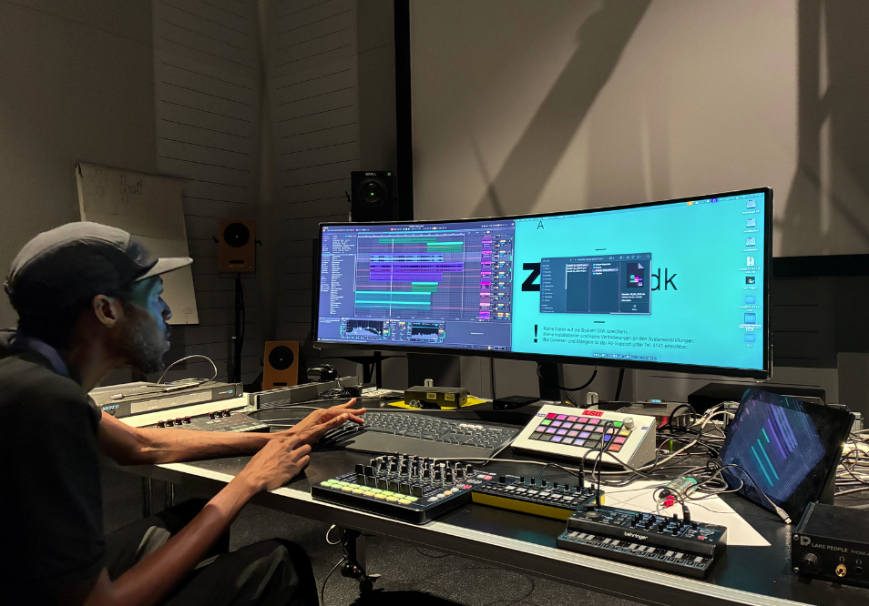
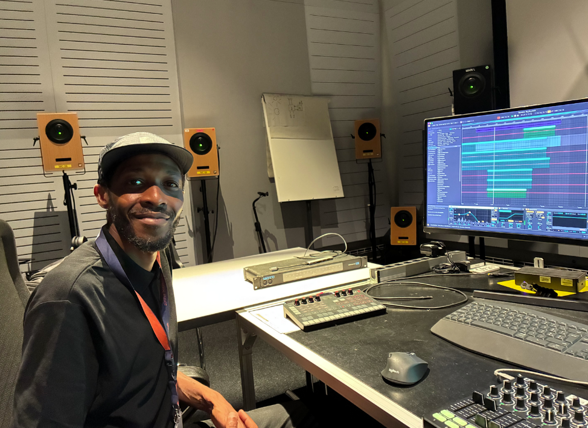

ICST Artist in Residence from **16.06.2025 to 06.07.2025** (Studio-Residence)

During his three-week ICST Studio Residency, Nandele Maguni produced a new release entitled “Kampfumo” based on his field recordings from Maputo.

## Exploring Sound at ZHdK – ICST

Being in residency at ZHdK – Zurich University of the Arts, within the ICST, has been an inspiring experience.

I'm currently developing the project Kampfumo, a sonic exploration based on the everyday soundscape of Maputo, especially the Chapa 100 transport system and the vibrant energy of the Kampfumo district.

At the ICST spatial audio studio, I’m experimenting with immersive technologies to create a cinematic and multidimensional listening experience.
This is not just about sound but movement, memory, and space.  

----
