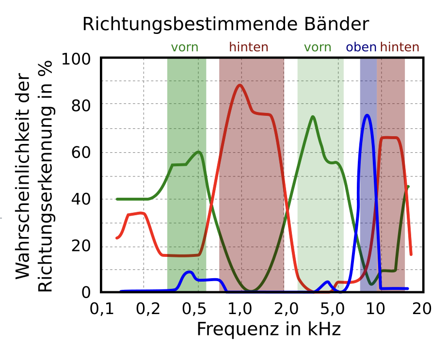
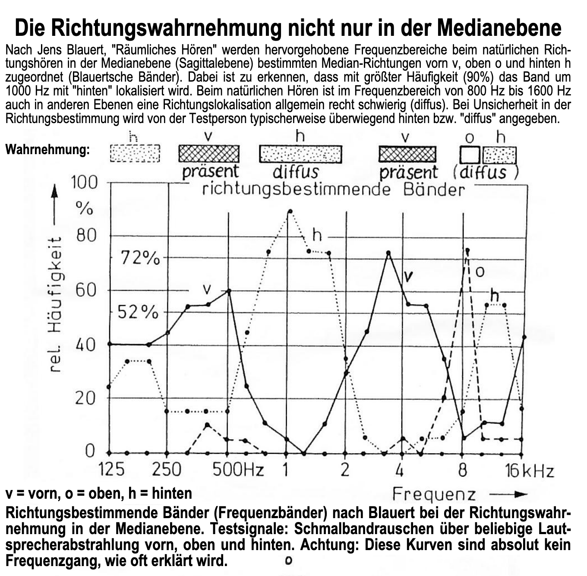
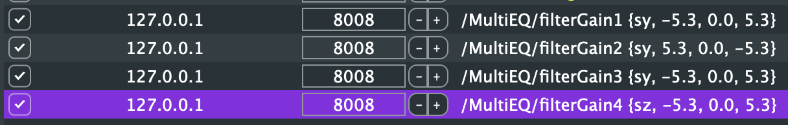
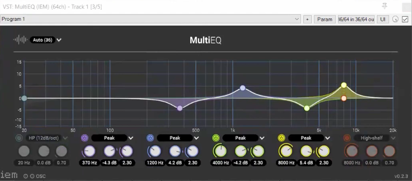
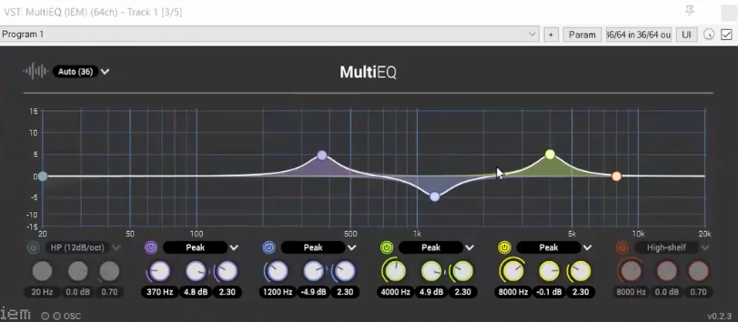
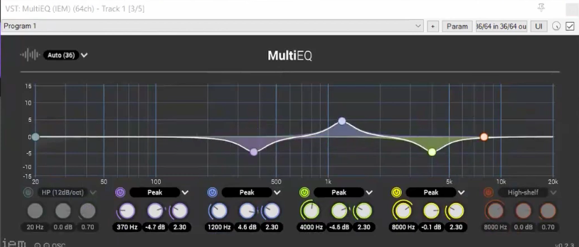

**Level:** Fortgeschritten | **Zielgruppe:** psychoakustisch orientierte Komponist:innen/Researcher.

<strong>Worum es in diesem Tutorial geht</strong>
Wie Blauertsche Bänder (frequenzabhängige Richtungswahrnehmung) die Wahrnehmung von vorne/hinten und Höhe in Ambisonics verstärken – indem die Y- und Z-Achse des ICST Encoders per OSC mit dem IEM MultiEQ gekoppelt werden.

Für die Stimme und ihre Richtungswahrnehmung habe ich Experimente mit den [Blauertschen Bändern](https://de.wikipedia.org/wiki/Blauertsche_B%C3%A4nder).

So habe ich Y vorne ↔ hinten und Z oben ↔ unten mit dem IEM-Multifilter gekoppelt.

---

## OSC-Routing

### Höhe (Z-Achse → IEM MultiEQ)

  
OSC OUT · Port 8008

  ICST Encoder OSC-Out Höhe → /MultiEQ/filterGain4 {sz, -5.3, 0.0, 5.3}

  
OSC IN · Port 8008

  Z → IEM MultiEQ: /MultiEQ/filterGain4 (Float)

### Vorne/Hinten (Y-Achse → IEM MultiEQ)

  
OSC OUT · Port 8008

  ICST Encoder OSC-Out Vorne → /MultiEQ/filterGain4 {sz, -5.3, 0.0, 5.3}

---

## IEM MultiEQ — Frequenzbänder

**Höhe (Anhebung bei 8 kHz)**

**Vorne**

**Hinten**

---

## Workflow-Schritte

  

1

Wie kann ich die Präsenz von vorne und hinten sowie das Gefühl von Höhen und Tiefen hörbarer machen?

  

2

OSC-Kommunikation zwischen Encoder (Y-, Z-Achse) und IEM MultiEQ (Blauertsche Bänder) erstellen.

  

3

AmbiEncoder-FX-Chain „Blauertsche Bänder-Ambi“ einrichten.

---

### Links
- [Blauertsche Bänder (Wikipedia)](https://de.wikipedia.org/wiki/Blauertsche_B%C3%A4nder)
- [sengpielaudio.com – Die Bedeutung der Blauert'schen Bänder (PDF)](https://sengpielaudio.com/DieBedeutungDerBlauertschenBaender.pdf)

