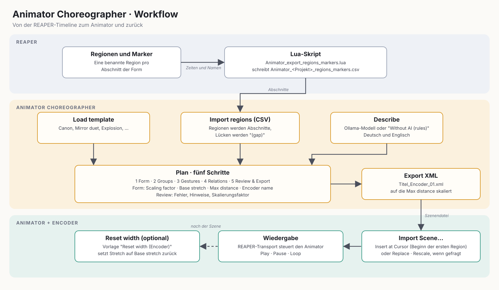

Level: Intermediate | **Zielgruppe:** Komponist:in, Sounddesigner:in | **Arbeitet mit:** [ICST Animator](/de/icst-ambisonics-plugins/11_animator/)

Der **Animator Choreographer** ist eine Desktop-App, mit der du planst, wie sich Gruppen von Quellen über die Zeit im Raum bewegen. Du beschreibst die Choreographie in Hörbegriffen (Richtung, Distanz, Höhe, Geste); die App erzeugt daraus die Szenen-XML, die der Animator im ICST AmbiEncoder_64 importiert und abspielt.


**Evaluationsbeta, nicht signiert.** macOS 15 und neuer: App öffnen, Meldung schliessen, dann **Systemeinstellungen › Datenschutz & Sicherheit › Dennoch öffnen** und mit dem Passwort bestätigen. Bis macOS 14 genügt beim ersten Start Ctrl-Klick › Öffnen. Alternative im Terminal: `xattr -dr com.apple.quarantine "Animator Choreographer.app"`. Windows: SmartScreen › **Weitere Informationen › Trotzdem ausführen**. Die Dokumentation folgt dem aktuellen Entwicklungsstand.



Eine kurze Referenzseite steht in der Plugin-Doku: [Animator Choreographer](/de/icst-ambisonics-plugins/20_animator_choreographer/).

## Was sie tut

- Erzeugt **Szenen-XML** für den Animator des ICST AmbiEncoder_64.
- Führt dich durch **fünf Schritte**, mit Draufsicht und Seitenansicht der Quellen, einer Zeitleiste mit Abschnitten und einem Transport (Leertaste = Start/Stopp).
- Übernimmt die **Abschnitte** des Stücks aus **REAPER-Regionen oder -Markern**.
- Kann einen **Plan aus einer Beschreibung** mit einem lokalen Sprachmodell entwerfen.
- Speichert Pläne als `.choreo.json` und öffnet vorhandene Animator-Exporte zur Ansicht oder Weiterbearbeitung.

## Voraussetzungen

| Punkt | Details |
|-------|---------|
| System | macOS 11+ (Universal), Windows 10/11 (x64), Linux x86_64 (glibc 2.35+) |
| Plug-ins | ICST Ambisonics Plugins mit dem Animator (AmbiEncoder_64) in REAPER |
| Optional | [Ollama](https://ollama.com) für den Entwurf aus einer Beschreibung |
| Lizenz | GPL-3.0 |

## Bezugsquelle

Version 0.1.0 steht als Evaluationsbeta für macOS, Windows und Linux auf GitHub. Dateien, Grössen und Prüfsummen:



Im vorkonfigurierten **ICST-Ambi-Reaper**-Ordner ist die macOS-App bereits enthalten: Sie liegt im Ordner `Animator`, und der Toolbar-Button 16 (*Animator öffnen*) startet sie. Die bebilderte Dokumentation dieses Ordners (`Docs/index.html`, Toolbar-Button *Documentation*) beschreibt Installation und erste Schritte.

## Ablauf



1. Optional die Regionen oder Marker deines REAPER-Projekts als CSV exportieren.
2. Die Choreographie in der App planen, Abschnitte importieren, Gruppen und Gesten anpassen.
3. Die Szene als XML exportieren.
4. Die XML im Animator importieren und abspielen.

## Die fünf Schritte

Die Schritte bauen aufeinander auf; bei Fehlern im Plan springt die App beim Export zu Schritt 5.

1. **Form** — Titel, Dauer und Abschnitte des Stücks. Abschnitte lassen sich aus REAPER importieren (siehe unten).
2. **Gruppen** — die Gruppen von Quellen, die sich gemeinsam bewegen.
3. **Gesten** — die Bewegung jeder Gruppe in jedem Abschnitt, in Hörbegriffen: Richtung, Distanz, Höhe, Geste und Kurve.
4. **Beziehungen** — wie die Gruppen zueinander stehen.
5. **Prüfen & Export** — den Plan prüfen und die XML schreiben.

## REAPER-Regionen importieren

Die Abschnitte deines Stücks liegen meist schon als Regionen in REAPER vor.

1. In REAPER das Skript `Animator_export_regions_markers.lua` ausführen (Actions › Load ReaScript). Es schreibt `Animator_<Projekt>_regions_markers.csv` (Zeiten in Sekunden) neben das Projekt. Im ICST-Ambi-Reaper-Ordner gibt es dieselbe Funktion als Aktion *Animator_Export_Regions_CSV*.
2. In der App den Schritt **Form** öffnen und **Import regions (CSV)** wählen.
3. Regionen werden zu Abschnitten. Lücken zwischen Regionen werden zu Abschnitten mit dem Namen *(gap)*. Hat das Projekt keine Regionen, begrenzen aufeinanderfolgende Marker die Abschnitte.

Die App nennt die Startzeit des ersten Abschnitts. Im Animator die Szene mit **Insert at Cursor** genau an dieser Position importieren.

## Plan aus einer Beschreibung

**Describe** in der Kopfleiste öffnet ein Fenster, in dem du die Choreographie in eigenen Worten beschreibst, zum Beispiel den Aufbau eines bedrohlichen Klangclusters, der am Ende implodiert.

- Ein lokales Sprachmodell entwirft einen **Plan**, nicht direkt die XML. Das Modell antwortet in Hörbegriffen, und ein Schema beschränkt die Antwort auf gültige Werte.
- Die App prüft den Entwurf (Planprüfung, Gruppenzahl, eine Zelle je Abschnitt, Gesamtdauer) und schickt Befunde bis zu zweimal zur Korrektur an das Modell zurück.
- **Apply** lädt das Ergebnis wie einen geöffneten Plan. Danach bleibt alles in den fünf Schritten editierbar.
- **Without AI (rules)** erzeugt stattdessen einen Entwurf mit dem eingebauten Regel-Planer, mit englischen und deutschen Stichwörtern und ohne Sprachmodell.
- Optionen: Gruppenzahl und Gesamtdauer (oder automatisch), das Modell unter den installierten und **Think**, das die Denkphase des Modells einschaltet (gründlicher, etwa fünf- bis zehnmal langsamer).

Die Beschreibung verlässt deinen Rechner nicht; die App spricht mit dem lokalen Ollama-Server unter `127.0.0.1:11434`. Cloud-Modelle werden nicht angeboten.

**Einrichtung:** Ollama installieren und starten, dann `ollama pull gemma4:12b` (etwa 8 GB, geeignet für 16 GB RAM). Kleiner ist `gemma4:e4b`.

### Beispiel: Tidal Canon

Diese Beschreibung ergibt einen Plan mit vier Stimmen und 90 Sekunden. Füge sie in **Describe** ein, stelle *Groups* auf 4 und *Duration* auf automatic und drücke **Draft**. Mit `gemma4:12b` dauert der Entwurf etwa zwei Minuten.

```text
Title: Tidal Canon.
1. Four voices start in the four corners at ear level, far away, and rest for 8 seconds.
2. For 12 seconds they move straight toward the centre and gather on a small circle (near).
3. For 20 seconds they circle the listener clockwise, two full turns, each voice offset by one quarter of a turn.
4. For 15 seconds the circle opens into a spiral that rises upward like a helix, ending high above the listener.
5. For 15 seconds they swing like pendulums from left to right, slowly slowing down.
6. For 12 seconds they drift randomly and softly, with gentle jitter.
7. For the last 8 seconds they move straight back to their starting corners and rest.
```


*Abbildung: animiertes GIF (läuft automatisch, in Schleife). Der Plan „Tidal Canon“ nach **Draft**: Vorschau mit vier Stimmen, Seitenansicht und Zeitleiste.*

Tipps: Gib jedem Abschnitt eine Dauer und eine Geste aus dem Menü (Rest, Move straight, Move in an arc, Circle, Spiral, Rising helix, Pendulum, Rose, Lissajous figure, Random drift, Path via stations). Nummerierte Abschnitte mit Sekundenangaben werden am zuverlässigsten umgesetzt. Der Entwurf bleibt danach vollständig editierbar.

## Export und Einsatz im Animator

1. In Schritt 5 **Export XML** wählen. Der Dateidialog schlägt `~/Documents/<titel>.xml` vor. Nach dem Speichern erscheint eine Bestätigung mit dem Pfad und **Show in Finder**.
2. Im Animator die Szene über den XML-Import laden (**Import Scene…**, mit den Optionen **Replace** und **Rescale**) und abspielen. Siehe die [Animator-Dokumentation](/de/icst-ambisonics-plugins/11_animator/).

Mit **Open XML** lädst du einen vorhandenen Animator-Export zur Ansicht oder Weiterbearbeitung.

## Einschränkungen

- Die Drehrichtung von Orbits ist in der Vorschau schematisch. Massgeblich ist die Wiedergabe im Animator.
- Plan-Dateien behalten interne deutsche Schlüssel, damit sie mit Dateien aus der Web-Version des Werkzeugs kompatibel bleiben.

## Lizenz

Der Code steht unter GPL3, weil Header der ICST Ambisonics Plugins (GPL3) enthalten sind. Die Schriften Inter und JetBrains Mono stehen unter der SIL Open Font License.

## Siehe auch

- [ICST Animator](/de/icst-ambisonics-plugins/11_animator/)
- [ICST Ambisonics EcoSystem](/de/ecosystem/)
