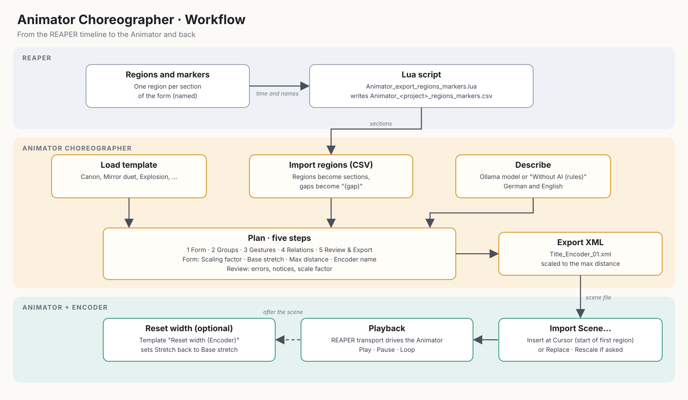

Level: Intermediate | **Audience:** Composer, sound designer | **Works with:** [ICST Animator](/icst-ambisonics-plugins/11_animator/)

The **Animator Choreographer** is a desktop app for planning how groups of sources move through space over time. You describe the choreography in listening terms (direction, distance, height, gesture) and the app generates the scene XML that the Animator in the ICST AmbiEncoder_64 imports and plays.


**Evaluation beta, unsigned.** macOS 15 and later: open the app, close the message, then go to **System Settings › Privacy & Security › Open Anyway** and confirm with your password. Up to macOS 14, Ctrl-click › Open on first launch is enough. Alternative in Terminal: `xattr -dr com.apple.quarantine "Animator Choreographer.app"`. Windows: SmartScreen › **More info › Run anyway**. The documentation follows the current state of development.



A short reference page is part of the plugin docs: [Animator Choreographer](/icst-ambisonics-plugins/20_animator_choreographer/).

## What it does

- Builds **scene XML** for the Animator of the ICST AmbiEncoder_64.
- Guides you through **five steps**, with a top view and a side view of the sources, a timeline with sections and a transport (space bar = start/stop).
- Takes the **sections** of the piece from **REAPER regions or markers**.
- Can **draft a plan from a description** with a local language model.
- Saves plans as `.choreo.json` and opens existing Animator exports for viewing or further editing.

## Requirements

| Item | Details |
|------|---------|
| System | macOS 11+ (Universal), Windows 10/11 (x64), Linux x86_64 (glibc 2.35+) |
| Plug-ins | ICST Ambisonics Plugins with the Animator (AmbiEncoder_64) in REAPER |
| Optional | [Ollama](https://ollama.com) for the draft from a description |
| Licence | GPL-3.0 |

## Where to get it

Version 0.1.0 is available on GitHub as an evaluation beta for macOS, Windows and Linux. Files, sizes and checksums:



The preconfigured **ICST Ambi Reaper** folder already contains the macOS app: it lives in the `Animator` folder, and toolbar button 13 (*Open Animator*) starts it. The illustrated documentation of that folder (`Docs/index.html`, toolbar button *Documentation*) covers installation and the first steps.

## Workflow



1. Optionally export the regions or markers of your REAPER project as CSV.
2. Plan the choreography in the app, import the sections, adjust groups and gestures.
3. Export the scene as XML.
4. Import the XML in the Animator and play it.

## The five steps

The steps follow one another; the app jumps to step 5 if the plan has errors on export.

1. **Form** — title, duration and sections of the piece. Sections can be imported from REAPER (see below).
2. **Groups** — the groups of sources that move together.
3. **Gestures** — the movement of each group in each section, described in listening terms: direction, distance, height, gesture and curve.
4. **Relations** — how groups relate to each other.
5. **Review & Export** — check the plan and write the XML.

## Import REAPER regions

The sections of your piece usually already exist as regions in REAPER.

1. In REAPER, run `Animator_export_regions_markers.lua` (Actions › Load ReaScript). It writes `Animator_<project>_regions_markers.csv` (times in seconds) next to the project. The ICST Ambi Reaper folder offers the same function as the action *Animator_Export_Regions_CSV*.
2. In the app, open step **Form** and choose **Import regions (CSV)**.
3. Regions become sections. Gaps between regions become sections named *(gap)*. If the project has no regions, consecutive markers delimit the sections.

The app reports the start time of the first section. In the Animator, import the scene with **Insert at Cursor** at exactly that position.

## Plan from a description

**Describe** in the header bar opens a window where you describe the choreography in your own words, for example the build-up of a threatening sound cluster that implodes at the end.

- A local language model drafts a **plan**, not the XML directly. The model answers in listening terms, and a schema restricts the answer to valid values.
- The app reviews the draft (plan review, group count, one cell per section, total duration) and sends findings back to the model for correction, up to two times.
- **Apply** loads the result like an opened plan. Afterwards everything remains editable in the five steps.
- **Without AI (rules)** builds a draft with the built-in rule planner instead, using English and German keywords and no language model.
- Options: number of groups and total duration (or automatic), the model among the installed ones, and **Think**, which enables the model's thinking phase (more thorough, roughly five to ten times slower).

The description never leaves your computer; the app talks to the local Ollama server at `127.0.0.1:11434`. Cloud models are not offered.

**Setup:** install and start Ollama, then `ollama pull gemma4:12b` (about 8 GB, suitable for 16 GB RAM). A smaller alternative is `gemma4:e4b`.

### Example: Tidal Canon

The following description produces a 90-second plan with four voices. Paste it into **Describe**, set *Groups* to 4 and *Duration* to automatic, then press **Draft**. With `gemma4:12b` the draft takes about two minutes.

```text
Title: Tidal Canon.
1. Four voices start in the four corners at ear level, far away, and rest for 8 seconds.
2. For 12 seconds they move straight toward the centre and gather on a small circle (near).
3. For 20 seconds they circle the listener clockwise, two full turns, each voice offset by one quarter of a turn.
4. For 15 seconds the circle opens into a spiral that rises upward like a helix, ending high above the listener.
5. For 15 seconds they swing like pendulums from left to right, slowly slowing down.
6. For 12 seconds they drift randomly and softly, with gentle jitter.
7. For the last 8 seconds they move straight back to their starting corners and rest.
```


*Figure: animated GIF (plays automatically, loops). The Tidal Canon plan after **Draft**: preview with four voices, side view and timeline.*

Tips: give every section a duration and one gesture from the menu (Rest, Move straight, Move in an arc, Circle, Spiral, Rising helix, Pendulum, Rose, Lissajous figure, Random drift, Path via stations). Numbered sections with seconds are followed most reliably. The draft remains fully editable afterwards.

## Export and use in the Animator

1. In step 5, choose **Export XML**. The file dialog suggests `~/Documents/<title>.xml`. After saving, a confirmation shows the path with **Show in Finder**.
2. In the Animator, load the scene via the XML import (**Import Scene…**, with the options **Replace** and **Rescale**) and play it. See the [Animator documentation](/icst-ambisonics-plugins/11_animator/).

Use **Open XML** to load an existing Animator export for viewing or further editing.

## Limitations

- The direction of rotation of orbits is schematic in the preview. Playback in the Animator is authoritative.
- Plan files keep internal German keys for compatibility with files from the web version of the tool.

## Licence

The code is licensed under GPL3, because headers of the ICST Ambisonics Plugins (GPL3) are included. The fonts Inter and JetBrains Mono are licensed under the SIL Open Font License.

## See also

- [ICST Animator](/icst-ambisonics-plugins/11_animator/)
- [ICST Ambisonics EcoSystem](/ecosystem/)
