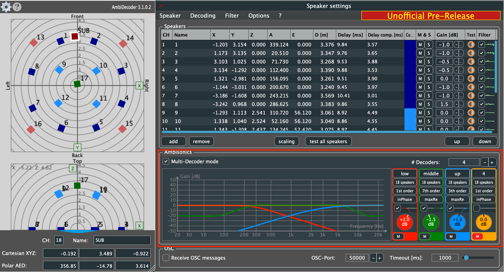
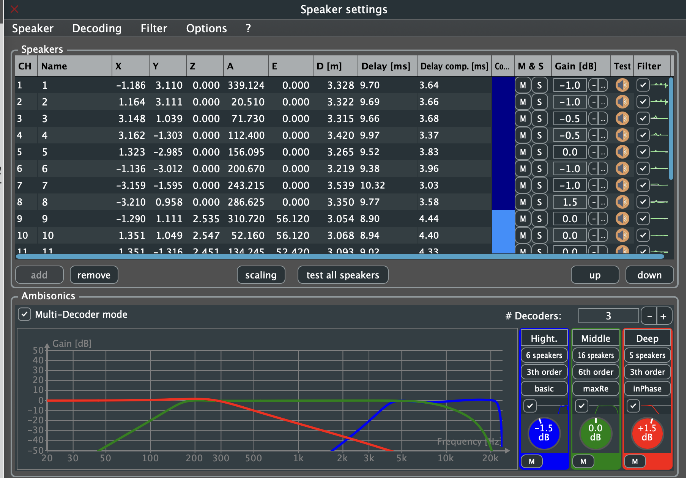

## Multi-Decoder Modus

**Für wen:** Level: Advanced | Zielgruppe: Techniker:in, Studio-Engineer.

Der **Multi-Decoder Modus**, eingeführt in **ICST AmbiDecoder v3.2**, ermöglicht es dir, bis zu **vier vollständig unabhängige Decoder** in einer einzelnen Plugin-Instanz auszuführen. Dies ist ideal für komplexe Lautsprechersetups, die unterschiedliche Lautsprecher-Arrays kombinieren, zum Beispiel einen Hauptambisonics-Ring zusammen mit Höhenlautsprechern, einer Subwoofer-Gruppe oder einem separaten Nahfeld-Array.

---

## Wann man den Multi-Decoder Modus verwendet

<figure style="margin:1.8rem 0">
<svg viewBox="0 0 720 234" style="width:100%;max-width:720px;height:auto;display:block" role="img" aria-label="Ein B-Format-Bus speist bis zu vier unabhängige Decoder-Slots mit eigenen Lautsprechern, Ordnung, Gewichtung und Filtern; ihre Ausgänge werden nacheinander vergeben." xmlns="http://www.w3.org/2000/svg"><defs><marker id="mx" viewBox="0 0 10 10" refX="9" refY="5" markerWidth="7" markerHeight="7" orient="auto"><path d="M0 0L10 5L0 10z" fill="currentColor"/></marker></defs><rect x="10" y="92" width="150" height="70" rx="8" stroke="currentColor" fill="currentColor" fill-opacity=".06" stroke-width="1.5"/><text x="85.0" y="124.0" text-anchor="middle" font-size="13" font-weight="600" fill="currentColor">B-Format-Bus</text><text x="85.0" y="141.0" text-anchor="middle" font-size="11" fill="currentColor" fill-opacity=".75">64 Kanäle</text><line x1="162" y1="127" x2="208" y2="33" stroke="currentColor" stroke-width="1.6" marker-end="url(#mx)"/><rect x="210" y="10" width="310" height="46" rx="8" stroke="#3fa968" fill="#3fa968" fill-opacity=".16" stroke-width="1.5"/><text x="365.0" y="30.0" text-anchor="middle" font-size="13" font-weight="600" fill="currentColor">A · Ring</text><text x="365.0" y="47.0" text-anchor="middle" font-size="11" fill="currentColor" fill-opacity=".75">eigene Lautsprecher · Ordnung · Gewichtung · Filter</text><line x1="522" y1="33" x2="548" y2="33" stroke="currentColor" stroke-width="1.6" marker-end="url(#mx)"/><line x1="162" y1="127" x2="208" y2="89" stroke="currentColor" stroke-width="1.6" marker-end="url(#mx)"/><rect x="210" y="66" width="310" height="46" rx="8" stroke="#4a8fe0" fill="#4a8fe0" fill-opacity=".16" stroke-width="1.5"/><text x="365.0" y="86.0" text-anchor="middle" font-size="13" font-weight="600" fill="currentColor">B · Height</text><text x="365.0" y="103.0" text-anchor="middle" font-size="11" fill="currentColor" fill-opacity=".75">eigene Lautsprecher · Ordnung · Gewichtung · Filter</text><line x1="522" y1="89" x2="548" y2="89" stroke="currentColor" stroke-width="1.6" marker-end="url(#mx)"/><line x1="162" y1="127" x2="208" y2="145" stroke="currentColor" stroke-width="1.6" marker-end="url(#mx)"/><rect x="210" y="122" width="310" height="46" rx="8" stroke="#d9534f" fill="#d9534f" fill-opacity=".16" stroke-width="1.5"/><text x="365.0" y="142.0" text-anchor="middle" font-size="13" font-weight="600" fill="currentColor">C · Sub</text><text x="365.0" y="159.0" text-anchor="middle" font-size="11" fill="currentColor" fill-opacity=".75">eigene Lautsprecher · Ordnung · Gewichtung · Filter</text><line x1="522" y1="145" x2="548" y2="145" stroke="currentColor" stroke-width="1.6" marker-end="url(#mx)"/><line x1="162" y1="127" x2="208" y2="201" stroke="currentColor" stroke-width="1.6" marker-end="url(#mx)"/><rect x="210" y="178" width="310" height="46" rx="8" stroke="#d9a441" fill="#d9a441" fill-opacity=".16" stroke-width="1.5"/><text x="365.0" y="198.0" text-anchor="middle" font-size="13" font-weight="600" fill="currentColor">D · Near</text><text x="365.0" y="215.0" text-anchor="middle" font-size="11" fill="currentColor" fill-opacity=".75">eigene Lautsprecher · Ordnung · Gewichtung · Filter</text><line x1="522" y1="201" x2="548" y2="201" stroke="currentColor" stroke-width="1.6" marker-end="url(#mx)"/><rect x="550" y="10" width="160" height="214" rx="8" stroke="currentColor" fill="currentColor" fill-opacity=".06" stroke-width="1.5"/><text x="630.0" y="114.0" text-anchor="middle" font-size="13" font-weight="600" fill="currentColor">Ausgänge</text><text x="630.0" y="131.0" text-anchor="middle" font-size="11" fill="currentColor" fill-opacity=".75">der Reihe nach A–D</text></svg>
<figcaption style="font-size:1.3rem;opacity:.8;margin-top:.6rem">Bis zu vier unabhängige Decoder teilen sich einen B-Format-Eingang.</figcaption>
</figure>

Verwende den Multi-Decoder Modus, wenn dein Setup enthält:

- **Mehrere Lautsprecherschichten** (z.B. horizontaler Ring + Höhenkuppel)
- **Mixed-Order Dekodierung** (z.B. 3. Ordnung für horizontal, 1. Ordnung für Höhe)
- **Unterschiedliche Lautsprechergeometrien**, die separate Presets benötigen
- **Unabhängige Gain- und Filtereinstellungen** pro Lautsprechergruppe

Für einfache Setups (einzelnes Array, einzelne Geometrie) ist der Standard-Single-Decoder-Modus ausreichend.

> [!Note]
> Der Multi-Decoder Modus ist keine direkte Umsetzung der Blauertschen Bänder oder eines anderen festen psychoakustischen Modells.
> Er versteht sich eher als **schichtbewusstes Dekodierungs-Werkzeug**: Du kannst verschiedene Strategien für unterschiedliche Lautsprecherzonen vergleichen und verfeinern, während dieselbe B-Format-Quelle erhalten bleibt.

---

## Aktivierung des Multi-Decoder Modus

1. Öffne das **ICST AmbiDecoder** Plugin in deiner REAPER FX-Kette.
2. Im **Decoder-Settings-Panel** findest du die **Multi-Decoder** Schaltfläche.
3. Aktiviere den Multi-Decoder Modus — vier Decoder-Slots (A, B, C, D) erscheinen.

> [!Tip]
> Jeder Decoder-Slot ist vollständig unabhängig und kann separat konfiguriert werden, ohne die anderen zu beeinflussen.

---

## Konfiguration jedes Decoders

Für jeden der vier Decoder kannst du einstellen:

### 1. Name und Farbe
- Gebe jedem Decoder einen aussagekräftigen Namen (z.B. "Ring", "Height", "Sub", "Near").
- Weise eine benutzerdefinierte Farbe für einfache Identifikation in der Benutzeroberfläche zu.

### 2. Lautsprecherauswahl
- Jeder Decoder hat seine **eigene Lautsprecherauswahl**.
- Weise spezifische Lautsprecher aus deinem Lautsprecherpreset jedem Decoder zu.
- Lautsprecher können immer nur zu einem Decoder gehören.

### 3. Ambisonics-Reihenfolge
- Stelle die **Dekodierreihenfolge unabhängig** pro Decoder ein (1. bis 7. Ordnung).
- Niedrigere Ordnungen (1.–2.) eignen sich für spärliche oder schwierige Lautsprechergeometrien.
- Höhere Ordnungen (3.–7.) geben präzisere Ortung für dichte Arrays.

### 4. Ambisonics-Gewichtung
- Wähle das Gewichtungsschema (z.B. MaxRe, inPhase, Basic) pro Decoder.
- MaxRe wird für die meisten praktischen Setups empfohlen.

### 5. Filter
- Acht Filteroptionen sind pro Decoder verfügbar.
- Passe pro-Decoder EQ und räumliche Filterung unabhängig an.

### 6. Stumm und Gain
- Jeder Decoder hat eine unabhängige **Stumm-Schaltfläche** und **Gain-Kontrolle**.
- Verwende Stumm, um einzelne Decoder während Setup und Tests zu isolieren.

---

## Routing in REAPER

<figure style="margin:1.8rem 0">
<svg viewBox="0 0 720 176" style="width:100%;max-width:720px;height:auto;display:block" role="img" aria-label="Die Ausgangskanäle werden der Reihe nach vergeben: Decoder A nutzt die Ausgänge 1 bis 8, Decoder B die Ausgänge 9 bis 12." xmlns="http://www.w3.org/2000/svg"><defs><marker id="mq" viewBox="0 0 10 10" refX="9" refY="5" markerWidth="7" markerHeight="7" orient="auto"><path d="M0 0L10 5L0 10z" fill="currentColor"/></marker></defs><text x="36" y="22" text-anchor="start" font-size="12" font-weight="600" fill="currentColor" fill-opacity="1">Track-Ausgangskanäle (der Reihe nach)</text><rect x="36" y="38" width="50" height="38" rx="6" fill="#3fa968" fill-opacity=".25" stroke="#3fa968" stroke-width="1.5"/><text x="61.0" y="62" text-anchor="middle" font-size="13" font-weight="600" fill="currentColor" fill-opacity="1">1</text><rect x="90" y="38" width="50" height="38" rx="6" fill="#3fa968" fill-opacity=".25" stroke="#3fa968" stroke-width="1.5"/><text x="115.0" y="62" text-anchor="middle" font-size="13" font-weight="600" fill="currentColor" fill-opacity="1">2</text><rect x="144" y="38" width="50" height="38" rx="6" fill="#3fa968" fill-opacity=".25" stroke="#3fa968" stroke-width="1.5"/><text x="169.0" y="62" text-anchor="middle" font-size="13" font-weight="600" fill="currentColor" fill-opacity="1">3</text><rect x="198" y="38" width="50" height="38" rx="6" fill="#3fa968" fill-opacity=".25" stroke="#3fa968" stroke-width="1.5"/><text x="223.0" y="62" text-anchor="middle" font-size="13" font-weight="600" fill="currentColor" fill-opacity="1">4</text><rect x="252" y="38" width="50" height="38" rx="6" fill="#3fa968" fill-opacity=".25" stroke="#3fa968" stroke-width="1.5"/><text x="277.0" y="62" text-anchor="middle" font-size="13" font-weight="600" fill="currentColor" fill-opacity="1">5</text><rect x="306" y="38" width="50" height="38" rx="6" fill="#3fa968" fill-opacity=".25" stroke="#3fa968" stroke-width="1.5"/><text x="331.0" y="62" text-anchor="middle" font-size="13" font-weight="600" fill="currentColor" fill-opacity="1">6</text><rect x="360" y="38" width="50" height="38" rx="6" fill="#3fa968" fill-opacity=".25" stroke="#3fa968" stroke-width="1.5"/><text x="385.0" y="62" text-anchor="middle" font-size="13" font-weight="600" fill="currentColor" fill-opacity="1">7</text><rect x="414" y="38" width="50" height="38" rx="6" fill="#3fa968" fill-opacity=".25" stroke="#3fa968" stroke-width="1.5"/><text x="439.0" y="62" text-anchor="middle" font-size="13" font-weight="600" fill="currentColor" fill-opacity="1">8</text><rect x="468" y="38" width="50" height="38" rx="6" fill="#4a8fe0" fill-opacity=".25" stroke="#4a8fe0" stroke-width="1.5"/><text x="493.0" y="62" text-anchor="middle" font-size="13" font-weight="600" fill="currentColor" fill-opacity="1">9</text><rect x="522" y="38" width="50" height="38" rx="6" fill="#4a8fe0" fill-opacity=".25" stroke="#4a8fe0" stroke-width="1.5"/><text x="547.0" y="62" text-anchor="middle" font-size="13" font-weight="600" fill="currentColor" fill-opacity="1">10</text><rect x="576" y="38" width="50" height="38" rx="6" fill="#4a8fe0" fill-opacity=".25" stroke="#4a8fe0" stroke-width="1.5"/><text x="601.0" y="62" text-anchor="middle" font-size="13" font-weight="600" fill="currentColor" fill-opacity="1">11</text><rect x="630" y="38" width="50" height="38" rx="6" fill="#4a8fe0" fill-opacity=".25" stroke="#4a8fe0" stroke-width="1.5"/><text x="655.0" y="62" text-anchor="middle" font-size="13" font-weight="600" fill="currentColor" fill-opacity="1">12</text><path d="M36 86 L36 92 L464 92 L464 86" fill="none" stroke="#3fa968" stroke-width="1.5"/><text x="250.0" y="112" text-anchor="middle" font-size="12" font-weight="600" fill="currentColor" fill-opacity="1">Decoder A · Ring</text><text x="250.0" y="128" text-anchor="middle" font-size="11" font-weight="400" fill="currentColor" fill-opacity="0.75">Ausgänge 1–8</text><path d="M468 86 L468 92 L680 92 L680 86" fill="none" stroke="#4a8fe0" stroke-width="1.5"/><text x="574.0" y="112" text-anchor="middle" font-size="12" font-weight="600" fill="currentColor" fill-opacity="1">Decoder B · Height</text><text x="574.0" y="128" text-anchor="middle" font-size="11" font-weight="400" fill="currentColor" fill-opacity="0.75">Ausgänge 9–12</text><circle cx="40.0" cy="158.0" r="3.5" fill="#d9534f" fill-opacity="0.9"/><text x="50" y="162" text-anchor="start" font-size="11" font-weight="400" fill="currentColor" fill-opacity="0.85">Zu wenige Track-Kanäle = stumme Lautsprecher, ohne Fehlermeldung.</text></svg>
<figcaption style="font-size:1.3rem;opacity:.8;margin-top:.6rem">Der Track braucht genug Ausgangskanäle für alle Lautsprecher aller Decoder.</figcaption>
</figure>

Bei Verwendung des Multi-Decoder Modus empfängt das Plugin immer noch denselben **B-Format Master Bus** als Eingabe. Das Routing innerhalb des Plugins verteilt das Signal intern auf jeden Decoder.

Ausgangskanäle werden sequenziell zugewiesen:
- Decoder A → Ausgänge 1–N (basierend auf seiner Lautsprecheranzahl)
- Decoder B → Ausgänge N+1–M
- Decoder C → setzt sich nach B fort
- Decoder D → setzt sich nach C fort

Stelle sicher, dass dein REAPER-Track genug Ausgangskanäle konfiguriert hat, um alle Lautsprecher über alle vier Decoder zu decken.

> [!Warning]
> Überprüfe deine Track-Kanalanzahl und das Routing sorgfältig. Fehlende Kanäle führen zu stillen Lautsprechern ohne Fehlermeldung.

---

## Lautsprecher-Test

Um jeden Decoder zu verifizieren:

1. **Stumme** Decoder B, C und D.
2. Klicke auf **Speaker Test** auf Decoder A und durchlaufe seine Lautsprecher.
3. Wiederhole für jeden Decoder, nachdem du ihn stummgeschaltet hast.

Verwende `Shift + Control + S` / `Shift + Control + M` (macOS) für tastaturgestützte Solo- und Stumm-Optionen während des Tests.

---

## Was der Multi-Decoder Modus nicht ist

Der Multi-Decoder Modus ist nicht:

- ein direkter Blauert-Band-Decoder
- für sich genommen ein Distanz-Renderer
- automatisch besser als ein einzelner Decoder
- ein Ersatz für korrekte Geometrie, Lautsprecher-Verifikation und Routing-Disziplin

Seine Stärke liegt im **kontrollierten Vergleich**: Du kannst Lautsprechergruppen trennen und testen, wie Ordnung, Gewichtung, Gain und Filterung das wahrgenommene Ergebnis beeinflussen.

---

## Beispiel: Horizontaler Ring + Höhenkuppel

<figure style="margin:1.8rem 0">
<svg viewBox="0 0 720 250" style="width:100%;max-width:720px;height:auto;display:block" role="img" aria-label="Oktagon-Ring aus acht Lautsprechern, in 3. Ordnung dekodiert, plus vier Höhenlautsprecher in 1. Ordnung, von oben gezeigt." xmlns="http://www.w3.org/2000/svg"><defs><marker id="ml" viewBox="0 0 10 10" refX="9" refY="5" markerWidth="7" markerHeight="7" orient="auto"><path d="M0 0L10 5L0 10z" fill="currentColor"/></marker></defs><circle cx="200" cy="125" r="100" fill="none" stroke="currentColor" stroke-opacity=".2" stroke-width="1" stroke-dasharray="3 4"/><circle cx="238.3" cy="32.6" r="11" fill="#3fa968" fill-opacity="0.9"/><text x="238.268343236509" y="36.61204674887132" text-anchor="middle" font-size="10" font-weight="600" fill="#fff" fill-opacity="1">1</text><circle cx="292.4" cy="86.7" r="11" fill="#3fa968" fill-opacity="0.9"/><text x="292.3879532511287" y="90.73165676349103" text-anchor="middle" font-size="10" font-weight="600" fill="#fff" fill-opacity="1">2</text><circle cx="292.4" cy="163.3" r="11" fill="#3fa968" fill-opacity="0.9"/><text x="292.3879532511287" y="167.26834323650897" text-anchor="middle" font-size="10" font-weight="600" fill="#fff" fill-opacity="1">3</text><circle cx="238.3" cy="217.4" r="11" fill="#3fa968" fill-opacity="0.9"/><text x="238.268343236509" y="221.3879532511287" text-anchor="middle" font-size="10" font-weight="600" fill="#fff" fill-opacity="1">4</text><circle cx="161.7" cy="217.4" r="11" fill="#3fa968" fill-opacity="0.9"/><text x="161.73165676349103" y="221.3879532511287" text-anchor="middle" font-size="10" font-weight="600" fill="#fff" fill-opacity="1">5</text><circle cx="107.6" cy="163.3" r="11" fill="#3fa968" fill-opacity="0.9"/><text x="107.61204674887132" y="167.268343236509" text-anchor="middle" font-size="10" font-weight="600" fill="#fff" fill-opacity="1">6</text><circle cx="107.6" cy="86.7" r="11" fill="#3fa968" fill-opacity="0.9"/><text x="107.61204674887132" y="90.73165676349103" text-anchor="middle" font-size="10" font-weight="600" fill="#fff" fill-opacity="1">7</text><circle cx="161.7" cy="32.6" r="11" fill="#3fa968" fill-opacity="0.9"/><text x="161.73165676349106" y="36.61204674887132" text-anchor="middle" font-size="10" font-weight="600" fill="#fff" fill-opacity="1">8</text><circle cx="233.9" cy="91.1" r="11" fill="#4a8fe0" fill-opacity="0.9"/><text x="233.94112549695427" y="95.05887450304573" text-anchor="middle" font-size="10" font-weight="600" fill="#fff" fill-opacity="1">9</text><circle cx="233.9" cy="158.9" r="11" fill="#4a8fe0" fill-opacity="0.9"/><text x="233.94112549695427" y="162.94112549695427" text-anchor="middle" font-size="10" font-weight="600" fill="#fff" fill-opacity="1">10</text><circle cx="166.1" cy="158.9" r="11" fill="#4a8fe0" fill-opacity="0.9"/><text x="166.05887450304573" y="162.94112549695427" text-anchor="middle" font-size="10" font-weight="600" fill="#fff" fill-opacity="1">11</text><circle cx="166.1" cy="91.1" r="11" fill="#4a8fe0" fill-opacity="0.9"/><text x="166.05887450304573" y="95.05887450304573" text-anchor="middle" font-size="10" font-weight="600" fill="#fff" fill-opacity="1">12</text><circle cx="200.0" cy="125.0" r="4" fill="currentColor" fill-opacity="1"/><rect x="400" y="50" width="300" height="56" rx="8" stroke="#3fa968" fill="#3fa968" fill-opacity=".16" stroke-width="1.5"/><text x="550.0" y="75.0" text-anchor="middle" font-size="13" font-weight="600" fill="currentColor">Decoder A · Ring</text><text x="550.0" y="92.0" text-anchor="middle" font-size="11" fill="currentColor" fill-opacity=".75">Lautsprecher 1–8 · 3. Ordnung · MaxRe</text><rect x="400" y="120" width="300" height="56" rx="8" stroke="#4a8fe0" fill="#4a8fe0" fill-opacity=".16" stroke-width="1.5"/><text x="550.0" y="145.0" text-anchor="middle" font-size="13" font-weight="600" fill="currentColor">Decoder B · Height</text><text x="550.0" y="162.0" text-anchor="middle" font-size="11" fill="currentColor" fill-opacity=".75">Lautsprecher 9–12 · 1. Ordnung · MaxRe</text><text x="550" y="205" text-anchor="middle" font-size="11" font-weight="400" fill="currentColor" fill-opacity="0.75">eigene Gain-Kompensation für die Höhenlautsprecher</text></svg>
<figcaption style="font-size:1.3rem;opacity:.8;margin-top:.6rem">Beispiel: Ring und Höhenschicht mit unabhängigen Decodern (Draufsicht).</figcaption>
</figure>

Ein häufiger Multi-Decoder-Anwendungsfall am ICST ist ein **Oktagon-Ring** (8 Lautsprecher, horizontal) kombiniert mit einer **Höhenschicht** (4 erhöhte Lautsprecher):

| Decoder | Lautsprecher        | Ordnung | Gewichtung |
|---------|----------------|-------|-----------|
| A       | Ring (1–8)      | 3.    | MaxRe     |
| B       | Height (9–12)   | 1.    | MaxRe     |

Dieses Setup ermöglicht eine feinabgestimmte Dekodierung für jede Schicht unabhängig, mit separater Gain-Kompensation für die Höhenlautsprecher.

---

## Beispiel: Drei Decoder nach Frequenzband mit Pegelabgleich

<figure style="margin:1.8rem 0">
<svg viewBox="0 0 720 200" style="width:100%;max-width:720px;height:auto;display:block" role="img" aria-label="Drei Decoder (Deep, Middle, High) haben je einen eigenen Decoder-Gain von plus 1,5, 0 und minus 1,5 Dezibel, danach folgt ein Gain pro einzelnem Lautsprecher." xmlns="http://www.w3.org/2000/svg"><defs><marker id="mg" viewBox="0 0 10 10" refX="9" refY="5" markerWidth="7" markerHeight="7" orient="auto"><path d="M0 0L10 5L0 10z" fill="currentColor"/></marker></defs><rect x="10" y="45" width="120" height="90" rx="8" stroke="currentColor" fill="currentColor" fill-opacity=".06" stroke-width="1.5"/><text x="70.0" y="87.0" text-anchor="middle" font-size="13" font-weight="600" fill="currentColor">B-Format-Bus</text><text x="70.0" y="104.0" text-anchor="middle" font-size="11" fill="currentColor" fill-opacity=".75">64 Kanäle</text><text x="305" y="18" text-anchor="middle" font-size="11" font-weight="600" fill="currentColor" fill-opacity=".75">Decoder</text><text x="465" y="18" text-anchor="middle" font-size="11" font-weight="600" fill="currentColor" fill-opacity=".75">Decoder-Gain</text><line x1="132" y1="90" x2="168" y2="52" stroke="currentColor" stroke-width="1.6" marker-end="url(#mg)"/><rect x="170" y="28" width="270" height="48" rx="8" stroke="#d9534f" fill="#d9534f" fill-opacity=".16" stroke-width="1.5"/><text x="305.0" y="49.0" text-anchor="middle" font-size="13" font-weight="600" fill="currentColor">Deep · 5 Lautsprecher</text><text x="305.0" y="66.0" text-anchor="middle" font-size="11" fill="currentColor" fill-opacity=".75">3. Ordnung · inPhase · Tiefpass</text><line x1="442" y1="52" x2="458" y2="52" stroke="currentColor" stroke-width="1.6" marker-end="url(#mg)"/><rect x="460" y="28" width="100" height="48" rx="8" stroke="#d9534f" fill="#d9534f" fill-opacity=".16" stroke-width="1.5"/><text x="510.0" y="57.0" text-anchor="middle" font-size="13" font-weight="600" fill="currentColor">+1,5 dB</text><line x1="562" y1="52" x2="578" y2="52" stroke="currentColor" stroke-width="1.6" marker-end="url(#mg)"/><line x1="132" y1="90" x2="168" y2="108" stroke="currentColor" stroke-width="1.6" marker-end="url(#mg)"/><rect x="170" y="84" width="270" height="48" rx="8" stroke="#3fa968" fill="#3fa968" fill-opacity=".16" stroke-width="1.5"/><text x="305.0" y="105.0" text-anchor="middle" font-size="13" font-weight="600" fill="currentColor">Middle · 16 Lautsprecher</text><text x="305.0" y="122.0" text-anchor="middle" font-size="11" fill="currentColor" fill-opacity=".75">6. Ordnung · maxRe · Bandpass</text><line x1="442" y1="108" x2="458" y2="108" stroke="currentColor" stroke-width="1.6" marker-end="url(#mg)"/><rect x="460" y="84" width="100" height="48" rx="8" stroke="#3fa968" fill="#3fa968" fill-opacity=".16" stroke-width="1.5"/><text x="510.0" y="113.0" text-anchor="middle" font-size="13" font-weight="600" fill="currentColor">0,0 dB</text><line x1="562" y1="108" x2="578" y2="108" stroke="currentColor" stroke-width="1.6" marker-end="url(#mg)"/><line x1="132" y1="90" x2="168" y2="164" stroke="currentColor" stroke-width="1.6" marker-end="url(#mg)"/><rect x="170" y="140" width="270" height="48" rx="8" stroke="#4a8fe0" fill="#4a8fe0" fill-opacity=".16" stroke-width="1.5"/><text x="305.0" y="161.0" text-anchor="middle" font-size="13" font-weight="600" fill="currentColor">High · 6 Lautsprecher</text><text x="305.0" y="178.0" text-anchor="middle" font-size="11" fill="currentColor" fill-opacity=".75">3. Ordnung · basic · Hochpass</text><line x1="442" y1="164" x2="458" y2="164" stroke="currentColor" stroke-width="1.6" marker-end="url(#mg)"/><rect x="460" y="140" width="100" height="48" rx="8" stroke="#4a8fe0" fill="#4a8fe0" fill-opacity=".16" stroke-width="1.5"/><text x="510.0" y="169.0" text-anchor="middle" font-size="13" font-weight="600" fill="currentColor">−1,5 dB</text><line x1="562" y1="164" x2="578" y2="164" stroke="currentColor" stroke-width="1.6" marker-end="url(#mg)"/><rect x="580" y="28" width="130" height="160" rx="8" stroke="currentColor" fill="currentColor" fill-opacity=".06" stroke-width="1.5"/><text x="645.0" y="105.0" text-anchor="middle" font-size="13" font-weight="600" fill="currentColor">Speaker-Gain</text><text x="645.0" y="122.0" text-anchor="middle" font-size="11" fill="currentColor" fill-opacity=".75">je Lautsprecher</text></svg>
<figcaption style="font-size:1.3rem;opacity:.8;margin-top:.6rem">Zwei Pegelstufen: pro Decoder und pro Lautsprecher. Beide addieren sich in dB.</figcaption>
</figure>

Ein reales ICST-Setup kann das System statt nach Schicht auch nach Frequenzband aufteilen. Drei Decoder laufen parallel, und jeder hat eine eigene Filterkurve, die von einem Band ins nächste übergibt:

| Decoder | Lautsprecher | Ordnung | Gewichtung | Gain | Filter (ca.) |
|---------|--------------|---------|------------|------|--------------|
| Deep    | 5            | 3.      | inPhase    | +1,5 dB | Tiefpass: voll unter ~300 Hz, darüber abfallend |
| Middle  | 16           | 6.      | maxRe      | 0,0 dB  | Bandpass, ~200 Hz bis ~5 kHz |
| High    | 6            | 3.      | basic      | −1,5 dB | Hochpass ab ~3 kHz |

Die Werte sind dem Screenshot entnommen; die Filtergrenzen sind ungefähre Angaben.

**Zwei Pegelstufen**

- **Pro Lautsprecher:** Die Spalte *Gain [dB]* in der Lautsprechertabelle trimmt einzelne Lautsprecher (hier zwischen −1,0 und +1,5 dB), etwa um Unterschiede bei Distanz, Lautsprechermodell oder Raum auszugleichen.
- **Pro Decoder:** Der Gain-Regler unten an jedem Decoder (hier +1,5, 0,0 und −1,5 dB) gleicht die Gruppen gegeneinander ab.

Beide addieren sich in dB. Arbeite von innen nach aussen:

1. **Innerhalb eines Decoders:** Rosa Rauschen nacheinander auf jeden einzelnen Lautsprecher geben (*Test*-Button) und am Hörplatz auf gleichen Pegel bringen.
2. **Zwischen den Decodern:** Die anderen Decoder stummschalten (*M*), jede Gruppe einzeln messen und den Decoder-Gain setzen.
3. **Alles zusammen:** Mit allen aktiven Decodern den Summenfrequenzgang am Hörplatz prüfen. Wo sich die Filterflanken überlappen, addieren sich die Pegel. Zum Schluss eine bewegte Quelle durch alle Zonen führen und auf Pegelsprünge hören.

---

## Weitere Ressourcen

- 📖 [ICST AmbiDecoder Wiki](https://github.com/schweizerweb/icst-ambisonics-plugins/wiki)
- 📥 [Download v3.2](https://github.com/schweizerweb/icst-ambisonics-plugins/releases)
- 📺 [Videos](/de/learn/videos/)

