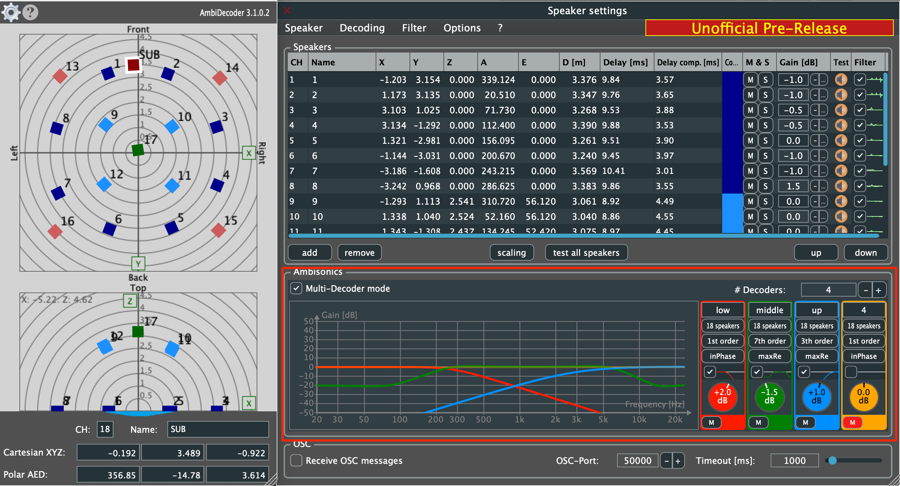
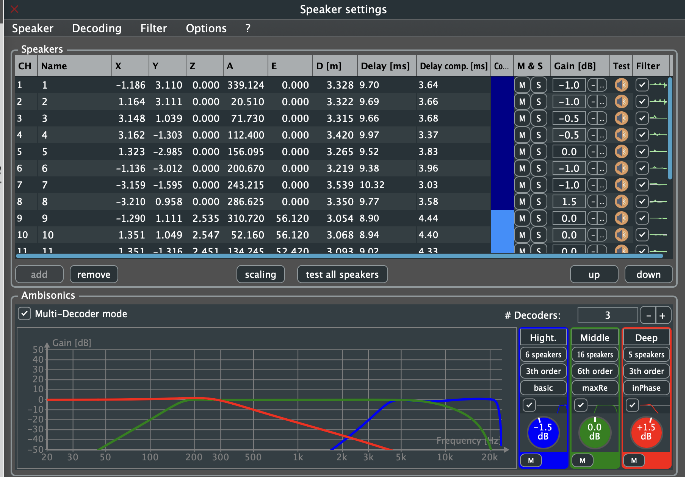

## Multi-Decoder Mode

Level: Advanced | **Audience:** Technician, Studio engineer.

The **Multi-Decoder Mode**, introduced in **ICST AmbiDecoder v3.2**, allows you to run up to **four fully independent decoders** within a single plugin instance. This is ideal for complex loudspeaker setups that combine different speaker arrays — for example, a main Ambisonics ring together with height speakers, a subwoofer group, or a separate near-field array.

---

## When to use Multi-Decoder Mode

<figure style="margin:1.8rem 0">
<svg viewBox="0 0 720 234" style="width:100%;max-width:720px;height:auto;display:block" role="img" aria-label="One B-format bus feeds up to four independent decoder slots, each with its own speakers, order, weighting and filters; their outputs are assigned one after another." xmlns="http://www.w3.org/2000/svg"><defs><marker id="mx" viewBox="0 0 10 10" refX="9" refY="5" markerWidth="7" markerHeight="7" orient="auto"><path d="M0 0L10 5L0 10z" fill="currentColor"/></marker></defs><rect x="10" y="92" width="150" height="70" rx="8" stroke="currentColor" fill="currentColor" fill-opacity=".06" stroke-width="1.5"/><text x="85.0" y="124.0" text-anchor="middle" font-size="13" font-weight="600" fill="currentColor">B-format bus</text><text x="85.0" y="141.0" text-anchor="middle" font-size="11" fill="currentColor" fill-opacity=".75">64 ch</text><line x1="162" y1="127" x2="208" y2="33" stroke="currentColor" stroke-width="1.6" marker-end="url(#mx)"/><rect x="210" y="10" width="310" height="46" rx="8" stroke="#3fa968" fill="#3fa968" fill-opacity=".16" stroke-width="1.5"/><text x="365.0" y="30.0" text-anchor="middle" font-size="13" font-weight="600" fill="currentColor">A · Ring</text><text x="365.0" y="47.0" text-anchor="middle" font-size="11" fill="currentColor" fill-opacity=".75">own speakers · order · weighting · filters</text><line x1="522" y1="33" x2="548" y2="33" stroke="currentColor" stroke-width="1.6" marker-end="url(#mx)"/><line x1="162" y1="127" x2="208" y2="89" stroke="currentColor" stroke-width="1.6" marker-end="url(#mx)"/><rect x="210" y="66" width="310" height="46" rx="8" stroke="#4a8fe0" fill="#4a8fe0" fill-opacity=".16" stroke-width="1.5"/><text x="365.0" y="86.0" text-anchor="middle" font-size="13" font-weight="600" fill="currentColor">B · Height</text><text x="365.0" y="103.0" text-anchor="middle" font-size="11" fill="currentColor" fill-opacity=".75">own speakers · order · weighting · filters</text><line x1="522" y1="89" x2="548" y2="89" stroke="currentColor" stroke-width="1.6" marker-end="url(#mx)"/><line x1="162" y1="127" x2="208" y2="145" stroke="currentColor" stroke-width="1.6" marker-end="url(#mx)"/><rect x="210" y="122" width="310" height="46" rx="8" stroke="#d9534f" fill="#d9534f" fill-opacity=".16" stroke-width="1.5"/><text x="365.0" y="142.0" text-anchor="middle" font-size="13" font-weight="600" fill="currentColor">C · Sub</text><text x="365.0" y="159.0" text-anchor="middle" font-size="11" fill="currentColor" fill-opacity=".75">own speakers · order · weighting · filters</text><line x1="522" y1="145" x2="548" y2="145" stroke="currentColor" stroke-width="1.6" marker-end="url(#mx)"/><line x1="162" y1="127" x2="208" y2="201" stroke="currentColor" stroke-width="1.6" marker-end="url(#mx)"/><rect x="210" y="178" width="310" height="46" rx="8" stroke="#d9a441" fill="#d9a441" fill-opacity=".16" stroke-width="1.5"/><text x="365.0" y="198.0" text-anchor="middle" font-size="13" font-weight="600" fill="currentColor">D · Near</text><text x="365.0" y="215.0" text-anchor="middle" font-size="11" fill="currentColor" fill-opacity=".75">own speakers · order · weighting · filters</text><line x1="522" y1="201" x2="548" y2="201" stroke="currentColor" stroke-width="1.6" marker-end="url(#mx)"/><rect x="550" y="10" width="160" height="214" rx="8" stroke="currentColor" fill="currentColor" fill-opacity=".06" stroke-width="1.5"/><text x="630.0" y="114.0" text-anchor="middle" font-size="13" font-weight="600" fill="currentColor">Speaker outputs</text><text x="630.0" y="131.0" text-anchor="middle" font-size="11" fill="currentColor" fill-opacity=".75">in order A–D</text></svg>
<figcaption style="font-size:1.3rem;opacity:.8;margin-top:.6rem">Up to four independent decoders share one B-format input.</figcaption>
</figure>

Use Multi-Decoder Mode when your setup includes:

- **Multiple speaker layers** (e.g. horizontal ring + height dome)
- **Mixed-order decoding** (e.g. 3rd order for horizontal, 1st order for height)
- **Different speaker geometries** that require separate presets
- **Independent gain and filter settings** per group of loudspeakers

For straightforward setups (single array, single geometry), the standard single-decoder mode is sufficient.

> [!Note]
> Multi-Decoder Mode is not a direct implementation of Blauert bands or any other fixed psychoacoustic model.
> It is better understood as a **layer-aware decoding tool**: you can compare and refine different strategies for different loudspeaker zones while keeping the same B-format source.

---

## Activating Multi-Decoder Mode

1. Open the **ICST AmbiDecoder** plugin in your REAPER FX chain.
2. In the **Decoder Settings** panel, locate the **Multi-Decoder** toggle.
3. Enable Multi-Decoder Mode — four decoder slots (A, B, C, D) will appear.

> [!Tip]
> Each decoder slot is fully independent and can be configured separately without affecting the others.

---

## Configuring Each Decoder

For each of the four decoders, you can set:

### 1. Name and Color
- Give each decoder a descriptive name (e.g. "Ring", "Height", "Sub", "Near").
- Assign a custom color for easy identification in the UI.

### 2. Loudspeaker Selection
- Each decoder has its **own speaker selection**.
- Assign specific speakers from your loudspeaker preset to each decoder.
- Speakers can only belong to one decoder at a time.

### 3. Ambisonics Order
- Set the **decoding order independently** per decoder (1st to 7th order).
- Lower orders (1st–2nd) are suitable for sparse or difficult speaker geometries.
- Higher orders (3rd–7th) give more precise localisation for dense arrays.

### 4. Ambisonics Weighting
- Choose the weighting scheme (e.g. MaxRe, inPhase, Basic) per decoder.
- MaxRe is recommended for most practical setups.

### 5. Filters
- Eight filter options are available per decoder.
- Adjust per-decoder EQ and spatial filtering independently.
- Use filters carefully and for clear reasons.
- In many cases, small layer-specific corrections are more useful than strong spectral reshaping.
- A height layer may benefit from slightly different spectral treatment than the main ring, but this should always be verified by listening on the real array.

### 6. Mute and Gain
- Each decoder has an independent **mute** button and **gain** control.
- Use mute to isolate individual decoders during setup and testing.

---

## Routing in REAPER

<figure style="margin:1.8rem 0">
<svg viewBox="0 0 720 176" style="width:100%;max-width:720px;height:auto;display:block" role="img" aria-label="Output channels are assigned in sequence: decoder A uses outputs 1 to 8, decoder B uses 9 to 12." xmlns="http://www.w3.org/2000/svg"><defs><marker id="mq" viewBox="0 0 10 10" refX="9" refY="5" markerWidth="7" markerHeight="7" orient="auto"><path d="M0 0L10 5L0 10z" fill="currentColor"/></marker></defs><text x="36" y="22" text-anchor="start" font-size="12" font-weight="600" fill="currentColor" fill-opacity="1">Track output channels (in sequence)</text><rect x="36" y="38" width="50" height="38" rx="6" fill="#3fa968" fill-opacity=".25" stroke="#3fa968" stroke-width="1.5"/><text x="61.0" y="62" text-anchor="middle" font-size="13" font-weight="600" fill="currentColor" fill-opacity="1">1</text><rect x="90" y="38" width="50" height="38" rx="6" fill="#3fa968" fill-opacity=".25" stroke="#3fa968" stroke-width="1.5"/><text x="115.0" y="62" text-anchor="middle" font-size="13" font-weight="600" fill="currentColor" fill-opacity="1">2</text><rect x="144" y="38" width="50" height="38" rx="6" fill="#3fa968" fill-opacity=".25" stroke="#3fa968" stroke-width="1.5"/><text x="169.0" y="62" text-anchor="middle" font-size="13" font-weight="600" fill="currentColor" fill-opacity="1">3</text><rect x="198" y="38" width="50" height="38" rx="6" fill="#3fa968" fill-opacity=".25" stroke="#3fa968" stroke-width="1.5"/><text x="223.0" y="62" text-anchor="middle" font-size="13" font-weight="600" fill="currentColor" fill-opacity="1">4</text><rect x="252" y="38" width="50" height="38" rx="6" fill="#3fa968" fill-opacity=".25" stroke="#3fa968" stroke-width="1.5"/><text x="277.0" y="62" text-anchor="middle" font-size="13" font-weight="600" fill="currentColor" fill-opacity="1">5</text><rect x="306" y="38" width="50" height="38" rx="6" fill="#3fa968" fill-opacity=".25" stroke="#3fa968" stroke-width="1.5"/><text x="331.0" y="62" text-anchor="middle" font-size="13" font-weight="600" fill="currentColor" fill-opacity="1">6</text><rect x="360" y="38" width="50" height="38" rx="6" fill="#3fa968" fill-opacity=".25" stroke="#3fa968" stroke-width="1.5"/><text x="385.0" y="62" text-anchor="middle" font-size="13" font-weight="600" fill="currentColor" fill-opacity="1">7</text><rect x="414" y="38" width="50" height="38" rx="6" fill="#3fa968" fill-opacity=".25" stroke="#3fa968" stroke-width="1.5"/><text x="439.0" y="62" text-anchor="middle" font-size="13" font-weight="600" fill="currentColor" fill-opacity="1">8</text><rect x="468" y="38" width="50" height="38" rx="6" fill="#4a8fe0" fill-opacity=".25" stroke="#4a8fe0" stroke-width="1.5"/><text x="493.0" y="62" text-anchor="middle" font-size="13" font-weight="600" fill="currentColor" fill-opacity="1">9</text><rect x="522" y="38" width="50" height="38" rx="6" fill="#4a8fe0" fill-opacity=".25" stroke="#4a8fe0" stroke-width="1.5"/><text x="547.0" y="62" text-anchor="middle" font-size="13" font-weight="600" fill="currentColor" fill-opacity="1">10</text><rect x="576" y="38" width="50" height="38" rx="6" fill="#4a8fe0" fill-opacity=".25" stroke="#4a8fe0" stroke-width="1.5"/><text x="601.0" y="62" text-anchor="middle" font-size="13" font-weight="600" fill="currentColor" fill-opacity="1">11</text><rect x="630" y="38" width="50" height="38" rx="6" fill="#4a8fe0" fill-opacity=".25" stroke="#4a8fe0" stroke-width="1.5"/><text x="655.0" y="62" text-anchor="middle" font-size="13" font-weight="600" fill="currentColor" fill-opacity="1">12</text><path d="M36 86 L36 92 L464 92 L464 86" fill="none" stroke="#3fa968" stroke-width="1.5"/><text x="250.0" y="112" text-anchor="middle" font-size="12" font-weight="600" fill="currentColor" fill-opacity="1">Decoder A · Ring</text><text x="250.0" y="128" text-anchor="middle" font-size="11" font-weight="400" fill="currentColor" fill-opacity="0.75">outputs 1–8</text><path d="M468 86 L468 92 L680 92 L680 86" fill="none" stroke="#4a8fe0" stroke-width="1.5"/><text x="574.0" y="112" text-anchor="middle" font-size="12" font-weight="600" fill="currentColor" fill-opacity="1">Decoder B · Height</text><text x="574.0" y="128" text-anchor="middle" font-size="11" font-weight="400" fill="currentColor" fill-opacity="0.75">outputs 9–12</text><circle cx="40.0" cy="158.0" r="3.5" fill="#d9534f" fill-opacity="0.9"/><text x="50" y="162" text-anchor="start" font-size="11" font-weight="400" fill="currentColor" fill-opacity="0.85">Too few track channels = silent speakers, without any error message.</text></svg>
<figcaption style="font-size:1.3rem;opacity:.8;margin-top:.6rem">The track needs enough output channels to cover all speakers of all decoders.</figcaption>
</figure>

When using Multi-Decoder Mode, the plugin still receives the same **B-Format master bus** as input. The routing within the plugin distributes the signal to each decoder internally.

Output channels are assigned sequentially:
- Decoder A → Outputs 1–N (based on its speaker count)
- Decoder B → Outputs N+1–M
- Decoder C → continues after B
- Decoder D → continues after C

Make sure your REAPER track has enough output channels configured to cover all speakers across all four decoders.

> [!Warning]
> Check your track channel count and routing carefully. Missing channels will result in silent speakers without any error message.

---

## Speaker Testing

To verify each decoder:

1. **Mute** decoders B, C, and D.
2. Click **Speaker Test** on decoder A and step through its speakers.
3. Repeat for each decoder after unmuting it.

Use `Shift + Control + S` / `Shift + Control + M` (macOS) for keyboard-based solo and mute during testing.

---

## What Multi-Decoder Mode is not

Multi-Decoder Mode is not:

- a direct Blauert-band decoder
- a distance renderer by itself
- automatically better than a single decoder
- a substitute for correct geometry, speaker verification, and routing discipline

Its strength lies in **controlled comparison**: you can separate loudspeaker groups and test how order, weighting, gain, and filtering affect the perceived result.

---

## Example: Horizontal Ring + Height Dome

<figure style="margin:1.8rem 0">
<svg viewBox="0 0 720 250" style="width:100%;max-width:720px;height:auto;display:block" role="img" aria-label="Octagon ring of eight speakers decoded at third order plus four height speakers decoded at first order, shown from above." xmlns="http://www.w3.org/2000/svg"><defs><marker id="ml" viewBox="0 0 10 10" refX="9" refY="5" markerWidth="7" markerHeight="7" orient="auto"><path d="M0 0L10 5L0 10z" fill="currentColor"/></marker></defs><circle cx="200" cy="125" r="100" fill="none" stroke="currentColor" stroke-opacity=".2" stroke-width="1" stroke-dasharray="3 4"/><circle cx="238.3" cy="32.6" r="11" fill="#3fa968" fill-opacity="0.9"/><text x="238.268343236509" y="36.61204674887132" text-anchor="middle" font-size="10" font-weight="600" fill="#fff" fill-opacity="1">1</text><circle cx="292.4" cy="86.7" r="11" fill="#3fa968" fill-opacity="0.9"/><text x="292.3879532511287" y="90.73165676349103" text-anchor="middle" font-size="10" font-weight="600" fill="#fff" fill-opacity="1">2</text><circle cx="292.4" cy="163.3" r="11" fill="#3fa968" fill-opacity="0.9"/><text x="292.3879532511287" y="167.26834323650897" text-anchor="middle" font-size="10" font-weight="600" fill="#fff" fill-opacity="1">3</text><circle cx="238.3" cy="217.4" r="11" fill="#3fa968" fill-opacity="0.9"/><text x="238.268343236509" y="221.3879532511287" text-anchor="middle" font-size="10" font-weight="600" fill="#fff" fill-opacity="1">4</text><circle cx="161.7" cy="217.4" r="11" fill="#3fa968" fill-opacity="0.9"/><text x="161.73165676349103" y="221.3879532511287" text-anchor="middle" font-size="10" font-weight="600" fill="#fff" fill-opacity="1">5</text><circle cx="107.6" cy="163.3" r="11" fill="#3fa968" fill-opacity="0.9"/><text x="107.61204674887132" y="167.268343236509" text-anchor="middle" font-size="10" font-weight="600" fill="#fff" fill-opacity="1">6</text><circle cx="107.6" cy="86.7" r="11" fill="#3fa968" fill-opacity="0.9"/><text x="107.61204674887132" y="90.73165676349103" text-anchor="middle" font-size="10" font-weight="600" fill="#fff" fill-opacity="1">7</text><circle cx="161.7" cy="32.6" r="11" fill="#3fa968" fill-opacity="0.9"/><text x="161.73165676349106" y="36.61204674887132" text-anchor="middle" font-size="10" font-weight="600" fill="#fff" fill-opacity="1">8</text><circle cx="233.9" cy="91.1" r="11" fill="#4a8fe0" fill-opacity="0.9"/><text x="233.94112549695427" y="95.05887450304573" text-anchor="middle" font-size="10" font-weight="600" fill="#fff" fill-opacity="1">9</text><circle cx="233.9" cy="158.9" r="11" fill="#4a8fe0" fill-opacity="0.9"/><text x="233.94112549695427" y="162.94112549695427" text-anchor="middle" font-size="10" font-weight="600" fill="#fff" fill-opacity="1">10</text><circle cx="166.1" cy="158.9" r="11" fill="#4a8fe0" fill-opacity="0.9"/><text x="166.05887450304573" y="162.94112549695427" text-anchor="middle" font-size="10" font-weight="600" fill="#fff" fill-opacity="1">11</text><circle cx="166.1" cy="91.1" r="11" fill="#4a8fe0" fill-opacity="0.9"/><text x="166.05887450304573" y="95.05887450304573" text-anchor="middle" font-size="10" font-weight="600" fill="#fff" fill-opacity="1">12</text><circle cx="200.0" cy="125.0" r="4" fill="currentColor" fill-opacity="1"/><rect x="400" y="50" width="300" height="56" rx="8" stroke="#3fa968" fill="#3fa968" fill-opacity=".16" stroke-width="1.5"/><text x="550.0" y="75.0" text-anchor="middle" font-size="13" font-weight="600" fill="currentColor">Decoder A · Ring</text><text x="550.0" y="92.0" text-anchor="middle" font-size="11" fill="currentColor" fill-opacity=".75">speakers 1–8 · 3rd order · MaxRe</text><rect x="400" y="120" width="300" height="56" rx="8" stroke="#4a8fe0" fill="#4a8fe0" fill-opacity=".16" stroke-width="1.5"/><text x="550.0" y="145.0" text-anchor="middle" font-size="13" font-weight="600" fill="currentColor">Decoder B · Height</text><text x="550.0" y="162.0" text-anchor="middle" font-size="11" fill="currentColor" fill-opacity=".75">speakers 9–12 · 1st order · MaxRe</text><text x="550" y="205" text-anchor="middle" font-size="11" font-weight="400" fill="currentColor" fill-opacity="0.75">separate gain compensation for the height speakers</text></svg>
<figcaption style="font-size:1.3rem;opacity:.8;margin-top:.6rem">Example: ring and height layer with independent decoders (top view).</figcaption>
</figure>

A common multi-decoder use case at ICST is an **Oktagon ring** (8 speakers, horizontal) combined with a **height layer** (4 elevated speakers):

| Decoder | Speakers        | Order | Weighting |
|---------|----------------|-------|-----------|
| A       | Ring (1–8)      | 3rd   | MaxRe     |
| B       | Height (9–12)   | 1st   | MaxRe     |

This setup allows fine-tuned decoding for each layer independently, with separate gain compensation for the height speakers.
The split can be useful because the horizontal ring and the height layer do not always benefit from identical decoding settings. The main ring often carries the most stable image, while the height layer may require more careful tuning to avoid sounding weak, blurry, or detached.

---

## Example: Three decoders by frequency band, with level matching

<figure style="margin:1.8rem 0">
<svg viewBox="0 0 720 200" style="width:100%;max-width:720px;height:auto;display:block" role="img" aria-label="Three decoders (Deep, Middle, High) each have their own decoder gain of plus 1.5, 0 and minus 1.5 decibels, followed by a gain per individual speaker." xmlns="http://www.w3.org/2000/svg"><defs><marker id="mg" viewBox="0 0 10 10" refX="9" refY="5" markerWidth="7" markerHeight="7" orient="auto"><path d="M0 0L10 5L0 10z" fill="currentColor"/></marker></defs><rect x="10" y="45" width="120" height="90" rx="8" stroke="currentColor" fill="currentColor" fill-opacity=".06" stroke-width="1.5"/><text x="70.0" y="87.0" text-anchor="middle" font-size="13" font-weight="600" fill="currentColor">B-format bus</text><text x="70.0" y="104.0" text-anchor="middle" font-size="11" fill="currentColor" fill-opacity=".75">64 ch</text><text x="305" y="18" text-anchor="middle" font-size="11" font-weight="600" fill="currentColor" fill-opacity=".75">Decoder</text><text x="465" y="18" text-anchor="middle" font-size="11" font-weight="600" fill="currentColor" fill-opacity=".75">Decoder gain</text><line x1="132" y1="90" x2="168" y2="52" stroke="currentColor" stroke-width="1.6" marker-end="url(#mg)"/><rect x="170" y="28" width="270" height="48" rx="8" stroke="#d9534f" fill="#d9534f" fill-opacity=".16" stroke-width="1.5"/><text x="305.0" y="49.0" text-anchor="middle" font-size="13" font-weight="600" fill="currentColor">Deep · 5 speakers</text><text x="305.0" y="66.0" text-anchor="middle" font-size="11" fill="currentColor" fill-opacity=".75">3rd order · inPhase · low-pass</text><line x1="442" y1="52" x2="458" y2="52" stroke="currentColor" stroke-width="1.6" marker-end="url(#mg)"/><rect x="460" y="28" width="100" height="48" rx="8" stroke="#d9534f" fill="#d9534f" fill-opacity=".16" stroke-width="1.5"/><text x="510.0" y="57.0" text-anchor="middle" font-size="13" font-weight="600" fill="currentColor">+1.5 dB</text><line x1="562" y1="52" x2="578" y2="52" stroke="currentColor" stroke-width="1.6" marker-end="url(#mg)"/><line x1="132" y1="90" x2="168" y2="108" stroke="currentColor" stroke-width="1.6" marker-end="url(#mg)"/><rect x="170" y="84" width="270" height="48" rx="8" stroke="#3fa968" fill="#3fa968" fill-opacity=".16" stroke-width="1.5"/><text x="305.0" y="105.0" text-anchor="middle" font-size="13" font-weight="600" fill="currentColor">Middle · 16 speakers</text><text x="305.0" y="122.0" text-anchor="middle" font-size="11" fill="currentColor" fill-opacity=".75">6th order · maxRe · band-pass</text><line x1="442" y1="108" x2="458" y2="108" stroke="currentColor" stroke-width="1.6" marker-end="url(#mg)"/><rect x="460" y="84" width="100" height="48" rx="8" stroke="#3fa968" fill="#3fa968" fill-opacity=".16" stroke-width="1.5"/><text x="510.0" y="113.0" text-anchor="middle" font-size="13" font-weight="600" fill="currentColor">0.0 dB</text><line x1="562" y1="108" x2="578" y2="108" stroke="currentColor" stroke-width="1.6" marker-end="url(#mg)"/><line x1="132" y1="90" x2="168" y2="164" stroke="currentColor" stroke-width="1.6" marker-end="url(#mg)"/><rect x="170" y="140" width="270" height="48" rx="8" stroke="#4a8fe0" fill="#4a8fe0" fill-opacity=".16" stroke-width="1.5"/><text x="305.0" y="161.0" text-anchor="middle" font-size="13" font-weight="600" fill="currentColor">High · 6 speakers</text><text x="305.0" y="178.0" text-anchor="middle" font-size="11" fill="currentColor" fill-opacity=".75">3rd order · basic · high-pass</text><line x1="442" y1="164" x2="458" y2="164" stroke="currentColor" stroke-width="1.6" marker-end="url(#mg)"/><rect x="460" y="140" width="100" height="48" rx="8" stroke="#4a8fe0" fill="#4a8fe0" fill-opacity=".16" stroke-width="1.5"/><text x="510.0" y="169.0" text-anchor="middle" font-size="13" font-weight="600" fill="currentColor">−1.5 dB</text><line x1="562" y1="164" x2="578" y2="164" stroke="currentColor" stroke-width="1.6" marker-end="url(#mg)"/><rect x="580" y="28" width="130" height="160" rx="8" stroke="currentColor" fill="currentColor" fill-opacity=".06" stroke-width="1.5"/><text x="645.0" y="105.0" text-anchor="middle" font-size="13" font-weight="600" fill="currentColor">Speaker gain</text><text x="645.0" y="122.0" text-anchor="middle" font-size="11" fill="currentColor" fill-opacity=".75">per speaker</text></svg>
<figcaption style="font-size:1.3rem;opacity:.8;margin-top:.6rem">Two levels of amplitude control: per decoder and per speaker. Both add up in dB.</figcaption>
</figure>

A real ICST setup can split the system by frequency band instead of by layer. Three decoders run in parallel, and each has its own filter curve that hands over from one band to the next:

| Decoder | Speakers | Order | Weighting | Gain | Filter (approx.) |
|---------|----------|-------|-----------|------|------------------|
| Deep    | 5        | 3rd   | inPhase   | +1.5 dB | low-pass: full below ~300 Hz, falling above |
| Middle  | 16       | 6th   | maxRe     | 0.0 dB  | band-pass, ~200 Hz to ~5 kHz |
| High    | 6        | 3rd   | basic     | −1.5 dB | high-pass from ~3 kHz |

The values are read from the screenshot; the filter edges are approximate.

**Two levels of amplitude control**

- **Per speaker:** the *Gain [dB]* column in the speaker table trims single speakers (here between −1.0 and +1.5 dB), for example to compensate differences in distance, speaker model or room.
- **Per decoder:** the gain knob at the bottom of each decoder (here +1.5, 0.0 and −1.5 dB) balances the groups against each other.

Both add up in dB. Work from the inside out:

1. **Within each decoder:** play pink noise through one speaker at a time (*Test* button) and match them to the same level at the listening position.
2. **Between decoders:** mute the other decoders (*M*), measure each group on its own and set the decoder gain.
3. **All together:** with all decoders active, check the summed frequency response at the listening position. Where the filter slopes overlap, the levels add up. Finally run a moving source through all zones and listen for level jumps.

---

## Further Resources

- 📖 [ICST AmbiDecoder Wiki](https://github.com/schweizerweb/icst-ambisonics-plugins/wiki)
- 📥 [Download v3.2](https://github.com/schweizerweb/icst-ambisonics-plugins/releases)
- 📺 [Videos](/learn/videos/)
