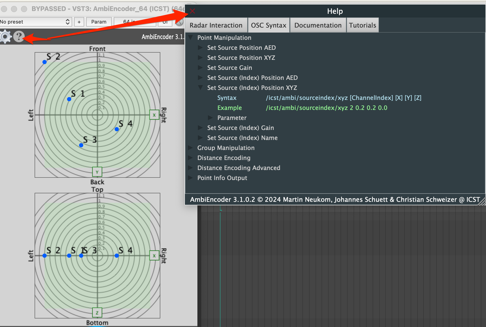
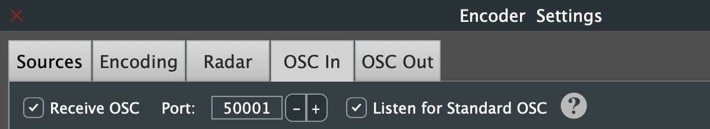
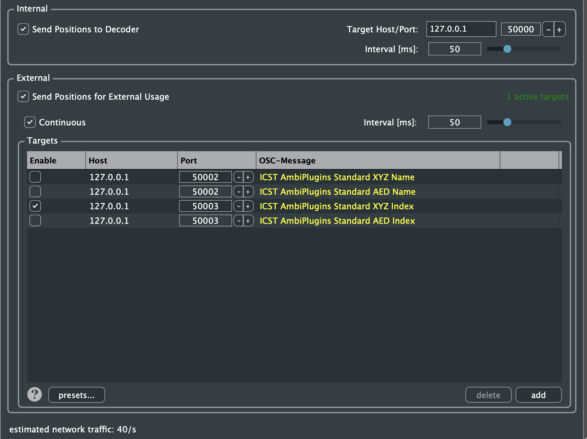
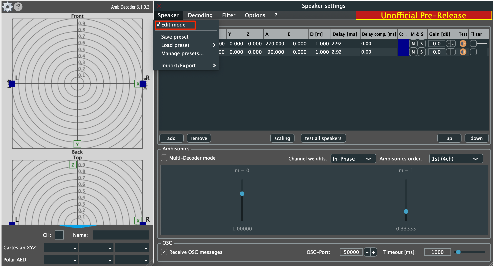
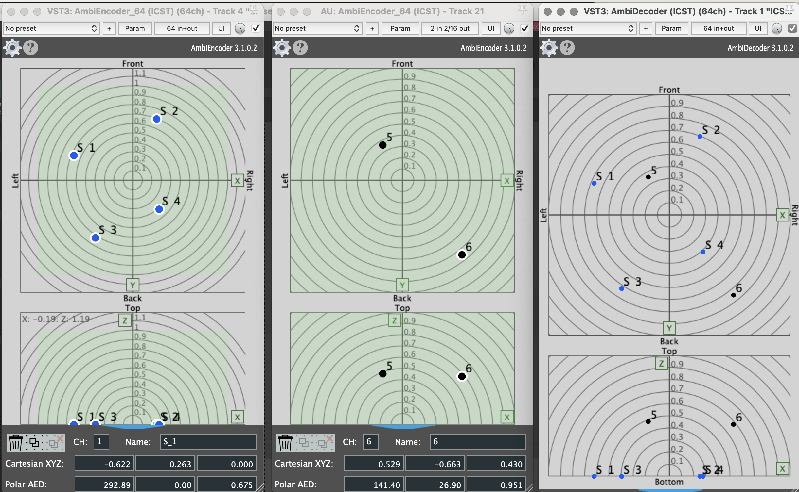

## OSC Syntax für das ICST AmbiEncoder Plugin

**Für wen:** Level: Advanced | Zielgruppe: Techniker:in, Developer, Max/OSC-User.

Der **ICST AmbiEncoder** unterstützt **OSC** und **JavaScript**, was eine nahtlose Kommunikation mit OSC-Tools wie **TouchOSC, IanniX, MaxMSP** und andere OSC-fähige Software ermöglicht.
Diese Seite ist die **Syntax-Referenz**.
Für Quickstart und Debugging-Reihenfolge nutze:
- [OSC im ICST AmbiEncoder - Die 10 wichtigsten Messages](/post/osc-10-key-messages/)

## **OSC Syntax & Adressspezifikation**

### **1. Zugriff auf OSC-Spezifikationen**

Klicke auf das **Fragezeichen** im ICST AmbiEncoder.
   

   _Abbildung: OSC-Spezifikationen im Help-Bereich._

Verfügbare Abschnitte:
- Help (**?**)
- OSC Syntax
- Sections
### **2. Eingehende OSC-Nachrichten**

<figure data-gen="g23" style="margin:1.8rem 0">
<svg viewBox="0 0 720 345" role="img" aria-label="Aufbau einer OSC-Nachricht für den AmbiEncoder: Adresse, Ziel, Format und Argumente" style="width:100%;height:auto;display:block" font-family="sans-serif" font-size="13" fill="currentColor"><defs><marker id="ara1" viewBox="0 0 10 10" refX="8" refY="5" markerWidth="7" markerHeight="7" orient="auto"><path d="M0,0L10,5L0,10z" fill="currentColor"/></marker></defs><rect x="28" y="26" width="118" height="38" rx="7" fill="currentColor" fill-opacity="0.12" stroke="#8a8a8a" stroke-width="1.5" opacity="1"/><text x="87.0" y="50.0" text-anchor="middle" font-family="ui-monospace,Menlo,Consolas,monospace" font-size="14">/icst/ambi</text><rect x="158" y="26" width="140" height="38" rx="7" fill="currentColor" fill-opacity="0.12" stroke="#4a8fe0" stroke-width="1.5" opacity="1"/><text x="228.0" y="50.0" text-anchor="middle" font-family="ui-monospace,Menlo,Consolas,monospace" font-size="14">/sourceindex</text><rect x="310" y="26" width="70" height="38" rx="7" fill="currentColor" fill-opacity="0.12" stroke="#3fa968" stroke-width="1.5" opacity="1"/><text x="345.0" y="50.0" text-anchor="middle" font-family="ui-monospace,Menlo,Consolas,monospace" font-size="14">/aed</text><rect x="392" y="26" width="52" height="38" rx="7" fill="currentColor" fill-opacity="0.12" stroke="#d9a441" stroke-width="1.5" opacity="1"/><text x="418.0" y="50.0" text-anchor="middle" font-family="ui-monospace,Menlo,Consolas,monospace" font-size="14">1</text><rect x="456" y="26" width="52" height="38" rx="7" fill="currentColor" fill-opacity="0.12" stroke="#d9a441" stroke-width="1.5" opacity="1"/><text x="482.0" y="50.0" text-anchor="middle" font-family="ui-monospace,Menlo,Consolas,monospace" font-size="14">45</text><rect x="520" y="26" width="52" height="38" rx="7" fill="currentColor" fill-opacity="0.12" stroke="#d9a441" stroke-width="1.5" opacity="1"/><text x="546.0" y="50.0" text-anchor="middle" font-family="ui-monospace,Menlo,Consolas,monospace" font-size="14">10</text><rect x="584" y="26" width="64" height="38" rx="7" fill="currentColor" fill-opacity="0.12" stroke="#d9a441" stroke-width="1.5" opacity="1"/><text x="616.0" y="50.0" text-anchor="middle" font-family="ui-monospace,Menlo,Consolas,monospace" font-size="14">0.8</text><text x="87" y="84" text-anchor="middle" font-weight="600" fill="#8a8a8a" font-size="11">Namespace</text><text x="87" y="98" text-anchor="middle" font-size="10"></text><text x="228" y="84" text-anchor="middle" font-weight="600" fill="#4a8fe0" font-size="11">source = Name (Symbol)</text><text x="228" y="98" text-anchor="middle" font-size="10">sourceindex = Index (int)</text><text x="345" y="84" text-anchor="middle" font-weight="600" fill="#3fa968" font-size="11">Format</text><text x="345" y="98" text-anchor="middle" font-size="10">aed oder xyz</text><text x="418" y="84" text-anchor="middle" font-weight="600" fill="#d9a441" font-size="11">Index</text><text x="418" y="98" text-anchor="middle" font-size="10">Integer</text><text x="482" y="84" text-anchor="middle" font-weight="600" fill="#d9a441" font-size="11">Azimut</text><text x="482" y="98" text-anchor="middle" font-size="10">Grad</text><text x="546" y="84" text-anchor="middle" font-weight="600" fill="#d9a441" font-size="11">Elevation</text><text x="546" y="98" text-anchor="middle" font-size="10">Grad</text><text x="616" y="84" text-anchor="middle" font-weight="600" fill="#d9a441" font-size="11">Distanz</text><text x="616" y="98" text-anchor="middle" font-size="10">0 bis 1</text><text x="360" y="126" text-anchor="middle" font-size="11">Beispiel: /icst/ambi/sourceindex/aed 1 45 10 0.8</text><text x="60" y="160" text-anchor="middle" font-size="11"></text><text x="305" y="160" text-anchor="middle" font-weight="600" font-size="12">AED (Azimut, Elevation, Distanz)</text><text x="577" y="160" text-anchor="middle" font-weight="600" font-size="12">XYZ (kartesisch)</text><text x="28" y="206" text-anchor="start" font-weight="600" font-size="12">nach Name</text><text x="28" y="222" text-anchor="start" font-size="10">(Symbol)</text><rect x="172" y="172" width="266" height="62" rx="8" fill="none" fill-opacity="0" stroke="currentColor" stroke-width="1.5" opacity="0.7"/><text x="305" y="198" text-anchor="middle" font-family="ui-monospace,Menlo,Consolas,monospace" font-size="12">/icst/ambi/source/aed</text><text x="305" y="219" text-anchor="middle" font-family="ui-monospace,Menlo,Consolas,monospace" font-size="11" fill="#d9a441">'S1'  45  10  0.8</text><rect x="444" y="172" width="266" height="62" rx="8" fill="none" fill-opacity="0" stroke="currentColor" stroke-width="1.5" opacity="0.7"/><text x="577" y="198" text-anchor="middle" font-family="ui-monospace,Menlo,Consolas,monospace" font-size="12">/icst/ambi/source/xyz</text><text x="577" y="219" text-anchor="middle" font-family="ui-monospace,Menlo,Consolas,monospace" font-size="11" fill="#d9a441">'S2'  0.2  0.2  0.0</text><text x="28" y="282" text-anchor="start" font-weight="600" font-size="12">nach Index</text><text x="28" y="298" text-anchor="start" font-size="10">(Integer, ab 1)</text><rect x="172" y="248" width="266" height="62" rx="8" fill="none" fill-opacity="0" stroke="currentColor" stroke-width="1.5" opacity="0.7"/><text x="305" y="274" text-anchor="middle" font-family="ui-monospace,Menlo,Consolas,monospace" font-size="12">/icst/ambi/sourceindex/aed</text><text x="305" y="295" text-anchor="middle" font-family="ui-monospace,Menlo,Consolas,monospace" font-size="11" fill="#d9a441">1  45  10  0.8</text><rect x="444" y="248" width="266" height="62" rx="8" fill="none" fill-opacity="0" stroke="currentColor" stroke-width="1.5" opacity="0.7"/><text x="577" y="274" text-anchor="middle" font-family="ui-monospace,Menlo,Consolas,monospace" font-size="12">/icst/ambi/sourceindex/xyz</text><text x="577" y="295" text-anchor="middle" font-family="ui-monospace,Menlo,Consolas,monospace" font-size="11" fill="#d9a441">2  0.2  0.2  0.0</text></svg>
<figcaption style="font-size:1.3rem;opacity:.8;margin-top:.6rem">Aufbau einer OSC-Nachricht: Namespace, Ziel, Format, danach die Argumente. Bei xyz sind die Argumente x, y, z statt Azimut, Elevation, Distanz.</figcaption>
</figure>


Nachrichten können sein:

- **Index-basiert** (Quellen-Index), z.B. `1`
- **Name-basiert** (Quellenname), z.B. `flute`
#### **Quellenposition setzen (AED Format)**
```
	/icst/ambi/source/aed [ChannelName] [Azimuth] [Elevation] [Distance]
	/icst/ambi/source/aed 'S1' 45 10 0.8
```

#### **Quellenposition setzen (XYZ Format)**

```
	/icst/ambi/source/xyz [ChannelName] [X] [Y] [Z]
	/icst/ambi/source/xyz 'S2' 0.2 0.2 0.0
```

**Hinweis:** Der Kanalname (z.B S1, S2) wird als **Symbol** gesendet.

#### **Quellenposition nach Index setzen (AED Format)**

```
/icst/ambi/sourceindex/aed [ChannelIndex] [Azimuth] [Elevation] [Distance]
/icst/ambi/sourceindex/aed 1 45 10 0.8
```
#### **Quellenposition nach Index setzen (XYZ Format)**

```
/icst/ambi/sourceindex/xyz [ChannelIndex] [X] [Y] [Z]
/icst/ambi/sourceindex/xyz 2 0.2 0.2 0.0
```
**Hinweis:** Kanal-Indizes werden als **Ganzzahlen** gesendet.

* * *

## **Positionen für externe Verwendung senden**

1. Öffne den Tab **'OSC Out'**.



**Hinweis:** Das Standard-Format der ICST AmbiPlugins sendet **Quellennamen als Symbole**. Max-Benutzer sollten eine **Custom OSC Message** definieren:

```
/icst/ambi/sourceindex/xyz {i} {x} {y} {z}
/icst/ambi/sourceindex/aed {i} {a} {e} {d}

```



_Abbildung: Custom 'OSC Out' Editor_

### **Interne OSC-Kommunikation**

Um **alle AmbiEncoder-Bewegungen** zum ICST AmbiDecoder zu senden:
1. Deaktiviere **Speaker Edit Mode** im AmbiDecoder.
2. Aktiviere den OSC-Port.






Jetzt empfängt der AmbiDecoder **alle OSC-Nachrichten** von allen verbundenen AmbiEncodern.

---
* * *


## Vollständige OSC-Referenz (aus GitHub-Quellcode)

> Abgeleitet aus dem Plugin-Quellcode ([OSCHandlerEncoder.h/.cpp](https://github.com/schweizerweb/icst-ambisonics-plugins/blob/main/Encoder/Source/OSCHandlerEncoder.h)). Ergänzt die oben dokumentierten Standard-Nachrichten um alle weiteren unterstützten Adressen.

### Quellen – Name-basiert

| OSC-Adresse | Argumente | Typ | Beschreibung |
|---|---|---|---|
| `/icst/ambi/source/aed` | `[Name] [A] [E] [D]` | string, float, float, float | Position setzen (Azimut/Elevation/Distanz) per Quellname |
| `/icst/ambi/source/xyz` | `[Name] [X] [Y] [Z]` | string, float, float, float | Position setzen (kartesisch) per Quellname |
| `/icst/ambi/source/gain` | `[Name] [Gain_dB]` | string, float | Gain setzen per Quellname |

### Quellen – Index-basiert

| OSC-Adresse | Argumente | Typ | Beschreibung |
|---|---|---|---|
| `/icst/ambi/sourceindex/aed` | `[Index] [A] [E] [D]` | int, float, float, float | Position setzen (AED) per Quellindex (1-basiert) |
| `/icst/ambi/sourceindex/xyz` | `[Index] [X] [Y] [Z]` | int, float, float, float | Position setzen (XYZ) per Quellindex (1-basiert) |
| `/icst/ambi/sourceindex/gain` | `[Index] [Gain_dB]` | int, float | Gain setzen per Quellindex |
| `/icst/ambi/sourceindex/name` | `[Index] [Name]` | int, string | Name der Quelle setzen per Index |

### Gruppen

| OSC-Adresse | Argumente | Typ | Beschreibung |
|---|---|---|---|
| `/icst/ambi/group/aed` | `[Name] [A] [E] [D] [MovePoints]` | string, float, float, float, int | Gruppenposition setzen (AED); MovePoints: 0=nur Gruppe, 1=mit Quellen |
| `/icst/ambi/group/xyz` | `[Name] [X] [Y] [Z] [MovePoints]` | string, float, float, float, int | Gruppenposition setzen (XYZ); MovePoints: 0/1 |
| `/icst/ambi/group/rotate` | `[Name] [Rx] [Ry] [Rz]` | string, float, float, float | Gruppe relativ rotieren (Euler, Grad) |
| `/icst/ambi/group/setrotation/euler` | `[Name] [Rx] [Ry] [Rz]` | string, float, float, float | Absolute Gruppenrotation setzen (Euler, Grad) |
| `/icst/ambi/group/setrotation/quaternion` | `[Name] [q1] [q2] [q3] [q4]` | string, float×4 | Absolute Gruppenrotation setzen (Quaternion) |
| `/icst/ambi/group/rotateorigin` | `[Name] [Rx] [Ry] [Rz] [MovePoints]` | string, float, float, float, int | Gruppe um den Ursprung rotieren |
| `/icst/ambi/group/stretch` | `[Name] [Factor]` | string, float | Gruppe relativ strecken/stauchen (relativ) |
| `/icst/ambi/group/setstretch` | `[Name] [Factor]` | string, float | Absolute Streckung der Gruppe setzen |

### Distance Encoding – Einzelparameter

| OSC-Adresse | Argumente | Typ | Beschreibung |
|---|---|---|---|
| `/icst/ambi/distanceencoding/mode` | `[Mode]` | int | Modus: 0=Standard, 1=Advanced, 2=Exponential, 3=InverseProportional |
| `/icst/ambi/distanceencoding/unitcircle` | `[Radius]` | float | Radius des Einheitskreises |
| `/icst/ambi/distanceencoding/dbunit` | `[dB]` | float | dB-Einheit für Abstandscodierung |
| `/icst/ambi/distanceencoding/distanceattenuation` | `[Value]` | float | Distanzabschwächung (nur Inverse Proportional) |
| `/icst/ambi/distanceencoding/centercurve` | `[Value]` | float | Center-Kurven-Parameter |
| `/icst/ambi/distanceencoding/advancedfactor` | `[Value]` | float | Advanced-Faktor |
| `/icst/ambi/distanceencoding/advancedexponent` | `[Value]` | float | Advanced-Exponent |

### Distance Encoding – Kombinierte Presets

| OSC-Adresse | Argumente | Typ | Beschreibung |
|---|---|---|---|
| `/icst/ambi/distanceencoding/standard` | `[UnitCircleRadius]` | float | Standard-Modus + Einheitskreis setzen |
| `/icst/ambi/distanceencoding/advanced` | `[UnitCircle] [Factor] [Exponent]` | float, float, float | Advanced-Modus mit 3 Parametern |
| `/icst/ambi/distanceencoding/exponential` | `[UnitCircle] [dBUnit] [CenterCurve]` | float, float, float | Exponential-Modus mit 3 Parametern |
| `/icst/ambi/distanceencoding/inverseproportional` | `[UnitCircle] [dBUnit] [CenterCurve] [DistAttn]` | float, float, float, float | Inverse-Proportional-Modus mit 4 Parametern |

### OSC Out – Custom Message Formate

| Format | Beschreibung |
|---|---|
| `/icst/ambi/sourceindex/xyz {i} {x} {y} {z}` | Positions-Ausgabe per Index (XYZ) |
| `/icst/ambi/sourceindex/aed {i} {a} {e} {d}` | Positions-Ausgabe per Index (AED) |

### MuseScore SSMN-Kompatibilität

| OSC-Adresse | Argumente | Beschreibung |
|---|---|---|
| `/aed` | `[CH] [A] [E] [D] [CH_check]` | MuseScore SSMN-Format (int, float, float, float, int) |

<p class="ai-credit" style="font-size:.85em;opacity:.7"><em>Diagramme und Erklärvideos mit Hilfe von Claude (Anthropic) erstellt. <a href="/de/about/#about-this-site">→</a></em></p>
