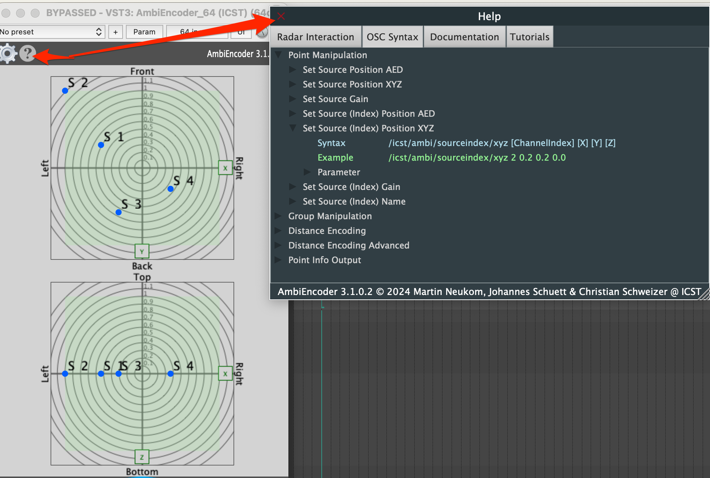
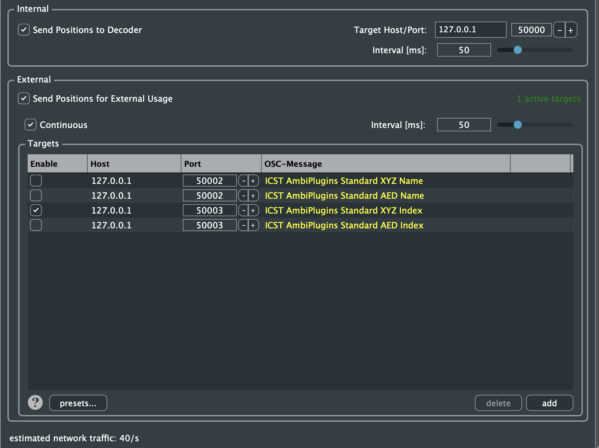
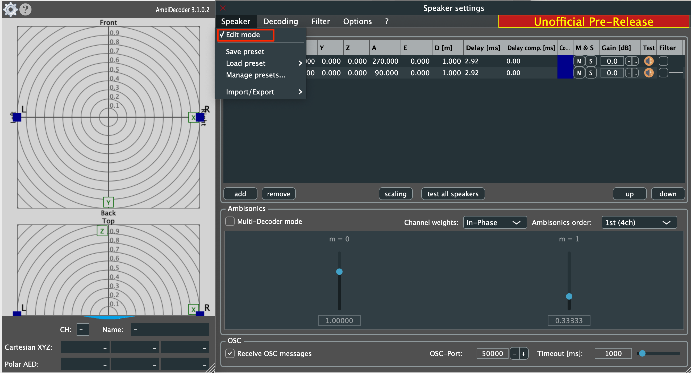
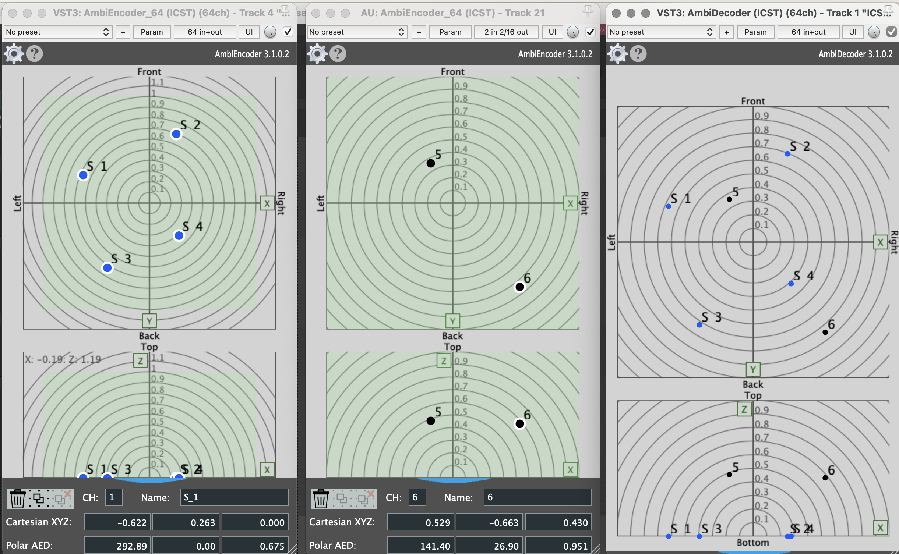

## OSC Syntax for the ICST AmbiEncoder Plugin

Level: Advanced | **Audience:** Technician, Developer, Max/OSC user.

The **ICST AmbiEncoder** supports **OSC** and **JavaScript**, enabling seamless communication with OSC tools such as **TouchOSC, IanniX, MaxMSP**, and other OSC-enabled software.
This page is the **syntax reference**.
For a practical quickstart and debugging sequence, use:
- [OSC im ICST AmbiEncoder - Die 10 wichtigsten Messages](/post/osc-10-key-messages/)

## **OSC Syntax & Address Specification**

### **1. Accessing OSC Specifications**

Click the **question mark** in the ICST AmbiEncoder.
   
   
   _Figure: OSC specifications in the Help section._

Available sections:
- Help (**?**)
- OSC Syntax
- Sections
### **2. Incoming OSC Messages**

<figure data-gen="g23" style="margin:1.8rem 0">
<svg viewBox="0 0 720 345" role="img" aria-label="Anatomy of an OSC message for the AmbiEncoder: address, target, format and arguments" style="width:100%;height:auto;display:block" font-family="sans-serif" font-size="13" fill="currentColor"><defs><marker id="ara1" viewBox="0 0 10 10" refX="8" refY="5" markerWidth="7" markerHeight="7" orient="auto"><path d="M0,0L10,5L0,10z" fill="currentColor"/></marker></defs><rect x="28" y="26" width="118" height="38" rx="7" fill="currentColor" fill-opacity="0.12" stroke="#8a8a8a" stroke-width="1.5" opacity="1"/><text x="87.0" y="50.0" text-anchor="middle" font-family="ui-monospace,Menlo,Consolas,monospace" font-size="14">/icst/ambi</text><rect x="158" y="26" width="140" height="38" rx="7" fill="currentColor" fill-opacity="0.12" stroke="#4a8fe0" stroke-width="1.5" opacity="1"/><text x="228.0" y="50.0" text-anchor="middle" font-family="ui-monospace,Menlo,Consolas,monospace" font-size="14">/sourceindex</text><rect x="310" y="26" width="70" height="38" rx="7" fill="currentColor" fill-opacity="0.12" stroke="#3fa968" stroke-width="1.5" opacity="1"/><text x="345.0" y="50.0" text-anchor="middle" font-family="ui-monospace,Menlo,Consolas,monospace" font-size="14">/aed</text><rect x="392" y="26" width="52" height="38" rx="7" fill="currentColor" fill-opacity="0.12" stroke="#d9a441" stroke-width="1.5" opacity="1"/><text x="418.0" y="50.0" text-anchor="middle" font-family="ui-monospace,Menlo,Consolas,monospace" font-size="14">1</text><rect x="456" y="26" width="52" height="38" rx="7" fill="currentColor" fill-opacity="0.12" stroke="#d9a441" stroke-width="1.5" opacity="1"/><text x="482.0" y="50.0" text-anchor="middle" font-family="ui-monospace,Menlo,Consolas,monospace" font-size="14">45</text><rect x="520" y="26" width="52" height="38" rx="7" fill="currentColor" fill-opacity="0.12" stroke="#d9a441" stroke-width="1.5" opacity="1"/><text x="546.0" y="50.0" text-anchor="middle" font-family="ui-monospace,Menlo,Consolas,monospace" font-size="14">10</text><rect x="584" y="26" width="64" height="38" rx="7" fill="currentColor" fill-opacity="0.12" stroke="#d9a441" stroke-width="1.5" opacity="1"/><text x="616.0" y="50.0" text-anchor="middle" font-family="ui-monospace,Menlo,Consolas,monospace" font-size="14">0.8</text><text x="87" y="84" text-anchor="middle" font-weight="600" fill="#8a8a8a" font-size="11">namespace</text><text x="87" y="98" text-anchor="middle" font-size="10"></text><text x="228" y="84" text-anchor="middle" font-weight="600" fill="#4a8fe0" font-size="11">source = name (symbol)</text><text x="228" y="98" text-anchor="middle" font-size="10">sourceindex = index (int)</text><text x="345" y="84" text-anchor="middle" font-weight="600" fill="#3fa968" font-size="11">format</text><text x="345" y="98" text-anchor="middle" font-size="10">aed or xyz</text><text x="418" y="84" text-anchor="middle" font-weight="600" fill="#d9a441" font-size="11">index</text><text x="418" y="98" text-anchor="middle" font-size="10">integer</text><text x="482" y="84" text-anchor="middle" font-weight="600" fill="#d9a441" font-size="11">azimuth</text><text x="482" y="98" text-anchor="middle" font-size="10">degrees</text><text x="546" y="84" text-anchor="middle" font-weight="600" fill="#d9a441" font-size="11">elevation</text><text x="546" y="98" text-anchor="middle" font-size="10">degrees</text><text x="616" y="84" text-anchor="middle" font-weight="600" fill="#d9a441" font-size="11">distance</text><text x="616" y="98" text-anchor="middle" font-size="10">0 to 1</text><text x="360" y="126" text-anchor="middle" font-size="11">Example: /icst/ambi/sourceindex/aed 1 45 10 0.8</text><text x="60" y="160" text-anchor="middle" font-size="11"></text><text x="305" y="160" text-anchor="middle" font-weight="600" font-size="12">AED (azimuth, elevation, distance)</text><text x="577" y="160" text-anchor="middle" font-weight="600" font-size="12">XYZ (cartesian)</text><text x="28" y="206" text-anchor="start" font-weight="600" font-size="12">by name</text><text x="28" y="222" text-anchor="start" font-size="10">(symbol)</text><rect x="172" y="172" width="266" height="62" rx="8" fill="none" fill-opacity="0" stroke="currentColor" stroke-width="1.5" opacity="0.7"/><text x="305" y="198" text-anchor="middle" font-family="ui-monospace,Menlo,Consolas,monospace" font-size="12">/icst/ambi/source/aed</text><text x="305" y="219" text-anchor="middle" font-family="ui-monospace,Menlo,Consolas,monospace" font-size="11" fill="#d9a441">'S1'  45  10  0.8</text><rect x="444" y="172" width="266" height="62" rx="8" fill="none" fill-opacity="0" stroke="currentColor" stroke-width="1.5" opacity="0.7"/><text x="577" y="198" text-anchor="middle" font-family="ui-monospace,Menlo,Consolas,monospace" font-size="12">/icst/ambi/source/xyz</text><text x="577" y="219" text-anchor="middle" font-family="ui-monospace,Menlo,Consolas,monospace" font-size="11" fill="#d9a441">'S2'  0.2  0.2  0.0</text><text x="28" y="282" text-anchor="start" font-weight="600" font-size="12">by index</text><text x="28" y="298" text-anchor="start" font-size="10">(integer, 1-based)</text><rect x="172" y="248" width="266" height="62" rx="8" fill="none" fill-opacity="0" stroke="currentColor" stroke-width="1.5" opacity="0.7"/><text x="305" y="274" text-anchor="middle" font-family="ui-monospace,Menlo,Consolas,monospace" font-size="12">/icst/ambi/sourceindex/aed</text><text x="305" y="295" text-anchor="middle" font-family="ui-monospace,Menlo,Consolas,monospace" font-size="11" fill="#d9a441">1  45  10  0.8</text><rect x="444" y="248" width="266" height="62" rx="8" fill="none" fill-opacity="0" stroke="currentColor" stroke-width="1.5" opacity="0.7"/><text x="577" y="274" text-anchor="middle" font-family="ui-monospace,Menlo,Consolas,monospace" font-size="12">/icst/ambi/sourceindex/xyz</text><text x="577" y="295" text-anchor="middle" font-family="ui-monospace,Menlo,Consolas,monospace" font-size="11" fill="#d9a441">2  0.2  0.2  0.0</text></svg>
<figcaption style="font-size:1.3rem;opacity:.8;margin-top:.6rem">Anatomy of an OSC message: namespace, target, format, then the arguments. With xyz the arguments are x, y, z instead of azimuth, elevation, distance.</figcaption>
</figure>


Messages can be:

- **Index-based** (source index), e.g., `1`
- **Name-based** (source name), e.g., `flute`
#### **Set Source Position (AED Format)**
```
	/icst/ambi/source/aed [ChannelName] [Azimuth] [Elevation] [Distance]
	/icst/ambi/source/aed 'S1' 45 10 0.8
```

#### **Set Source Position (XYZ Format)**
	
```
	/icst/ambi/source/xyz [ChannelName] [X] [Y] [Z]
	/icst/ambi/source/xyz 'S2' 0.2 0.2 0.0
```

**Note:** The channel name (e.g S1, S2) will be sent as **symbol**.

#### **Set Source (Index) Position (AED Format)**

```
/icst/ambi/sourceindex/aed [ChannelIndex] [Azimuth] [Elevation] [Distance]
/icst/ambi/sourceindex/aed 1 45 10 0.8
```
#### **Set Source (Index) Position (XYZ Format)**

```
/icst/ambi/sourceindex/xyz [ChannelIndex] [X] [Y] [Z]
/icst/ambi/sourceindex/xyz 2 0.2 0.2 0.0
```
**Note:** Channel indices are sent as **integers**.

* * *

## **Sending Positions for External Usage**

1. Open the **'OSC Out'** tab.


**Note:** The ICST AmbiPlugins standard format sends **source names as symbols**. Max users should define a **Custom OSC Message**:

```
/icst/ambi/sourceindex/xyz {i} {x} {y} {z}
/icst/ambi/sourceindex/aed {i} {a} {e} {d}

```



_Figure: Custom 'OSC Out' Editor_

#### **Internal OSC Communication**

To send **all AmbiEncoder movements** to the ICST AmbiDecoder:
1. Deactivate **Speaker Edit Mode** in the AmbiDecoder.
2. Activate the OSC port.






Now, the AmbiDecoder receives **all OSC messages** from all connected AmbiEncoders.

---
* * *


## Complete OSC reference (from the GitHub source code)

> Derived from the plugin source code ([OSCHandlerEncoder.h/.cpp](https://github.com/schweizerweb/icst-ambisonics-plugins/blob/main/Encoder/Source/OSCHandlerEncoder.h)). Adds all further supported addresses to the standard messages documented above.

### Sources – by name

| OSC address | Arguments | Type | Description |
|---|---|---|---|
| `/icst/ambi/source/aed` | `[Name] [A] [E] [D]` | string, float, float, float | Set position (azimuth/elevation/distance) by source name |
| `/icst/ambi/source/xyz` | `[Name] [X] [Y] [Z]` | string, float, float, float | Set position (Cartesian) by source name |
| `/icst/ambi/source/gain` | `[Name] [Gain_dB]` | string, float | Set gain by source name |

### Sources – by index

| OSC address | Arguments | Type | Description |
|---|---|---|---|
| `/icst/ambi/sourceindex/aed` | `[Index] [A] [E] [D]` | int, float, float, float | Set position (AED) by source index (1-based) |
| `/icst/ambi/sourceindex/xyz` | `[Index] [X] [Y] [Z]` | int, float, float, float | Set position (XYZ) by source index (1-based) |
| `/icst/ambi/sourceindex/gain` | `[Index] [Gain_dB]` | int, float | Set gain by source index |
| `/icst/ambi/sourceindex/name` | `[Index] [Name]` | int, string | Set source name by index |

### Groups

| OSC address | Arguments | Type | Description |
|---|---|---|---|
| `/icst/ambi/group/aed` | `[Name] [A] [E] [D] [MovePoints]` | string, float, float, float, int | Set group position (AED); MovePoints: 0 = group only, 1 = with sources |
| `/icst/ambi/group/xyz` | `[Name] [X] [Y] [Z] [MovePoints]` | string, float, float, float, int | Set group position (XYZ); MovePoints: 0/1 |
| `/icst/ambi/group/rotate` | `[Name] [Rx] [Ry] [Rz]` | string, float, float, float | Rotate group relatively (Euler, degrees) |
| `/icst/ambi/group/setrotation/euler` | `[Name] [Rx] [Ry] [Rz]` | string, float, float, float | Set absolute group rotation (Euler, degrees) |
| `/icst/ambi/group/setrotation/quaternion` | `[Name] [q1] [q2] [q3] [q4]` | string, float×4 | Set absolute group rotation (quaternion) |
| `/icst/ambi/group/rotateorigin` | `[Name] [Rx] [Ry] [Rz] [MovePoints]` | string, float, float, float, int | Rotate group around the origin |
| `/icst/ambi/group/stretch` | `[Name] [Factor]` | string, float | Stretch/compress group relatively |
| `/icst/ambi/group/setstretch` | `[Name] [Factor]` | string, float | Set absolute group stretch |

### Distance encoding – single parameters

| OSC address | Arguments | Type | Description |
|---|---|---|---|
| `/icst/ambi/distanceencoding/mode` | `[Mode]` | int | Mode: 0=Standard, 1=Advanced, 2=Exponential, 3=InverseProportional |
| `/icst/ambi/distanceencoding/unitcircle` | `[Radius]` | float | Unit circle radius |
| `/icst/ambi/distanceencoding/dbunit` | `[dB]` | float | dB unit for distance encoding |
| `/icst/ambi/distanceencoding/distanceattenuation` | `[Value]` | float | Distance attenuation (Inverse Proportional only) |
| `/icst/ambi/distanceencoding/centercurve` | `[Value]` | float | Center curve parameter |
| `/icst/ambi/distanceencoding/advancedfactor` | `[Value]` | float | Advanced factor |
| `/icst/ambi/distanceencoding/advancedexponent` | `[Value]` | float | Advanced exponent |

### Distance encoding – combined presets

| OSC address | Arguments | Type | Description |
|---|---|---|---|
| `/icst/ambi/distanceencoding/standard` | `[UnitCircleRadius]` | float | Set Standard mode + unit circle |
| `/icst/ambi/distanceencoding/advanced` | `[UnitCircle] [Factor] [Exponent]` | float, float, float | Advanced mode with 3 parameters |
| `/icst/ambi/distanceencoding/exponential` | `[UnitCircle] [dBUnit] [CenterCurve]` | float, float, float | Exponential mode with 3 parameters |
| `/icst/ambi/distanceencoding/inverseproportional` | `[UnitCircle] [dBUnit] [CenterCurve] [DistAttn]` | float, float, float, float | Inverse Proportional mode with 4 parameters |

### OSC Out – custom message formats

| Format | Description |
|---|---|
| `/icst/ambi/sourceindex/xyz {i} {x} {y} {z}` | Position output by index (XYZ) |
| `/icst/ambi/sourceindex/aed {i} {a} {e} {d}` | Position output by index (AED) |

### MuseScore SSMN compatibility

| OSC address | Arguments | Description |
|---|---|---|
| `/aed` | `[CH] [A] [E] [D] [CH_check]` | MuseScore SSMN format (int, float, float, float, int) |
